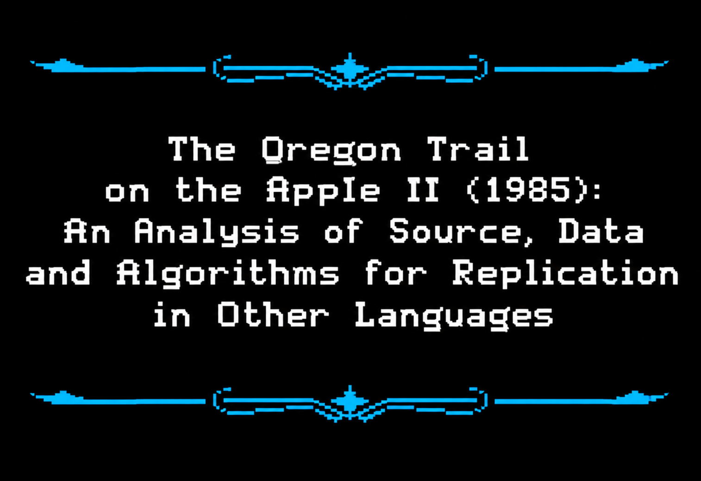

# The Oregon Trail on the Apple II (1985): An Analysis of Source, Data and Algorithms for Replication in Other Languages

By G. Paganelli - rift-demote-fence@duck.com

**This repository is primarily a research paper on *The Oregon Trail*
for the Apple II**, specifically version 1.4, the 1985 MECC release by R. Philip Bouchard (design), John Krenz
(lead programmer), Charolyn Kapplinger (art), with Shirley Keran, Bob Granvin,
Roger Shimada and Steve Splinter.

The question the paper asks is simple: **can anyone else write this game again
based on this paper and its artefacts, and get the same behaviour?**

The paper answers it by documenting the actual BASIC code, the machine code, variables, algorithms, tables, and various data. It also finds the places where the documented behaviour and the program behaviour disagree.

---

## What is where

| Folder | Contents |
| --- | --- |
| [`paper/`](paper/) | The paper and its public appendices (D to H). This is the main work. |
| [`game/`](game/) | Everything about the Python rebuild of the game: the `oregon` package, its tests and tools, the experiment script with a small sample of its results, and `NOTES.md`. |
| [`images/`](images/) | The title image at the top of this page. |

---

## The paper

| | |
| --- | --- |
| [`paper/01-paper.md`](paper/01-paper.md) | The paper. Fourteen sections covering set-up, the daily cycle, health, weather, the fifteen random events, rivers, forts, trading, endings, the two arcade games, and what the Applesoft ROM does to every number. |
| [`paper/02-appendix-d-dialogue.md`](paper/02-appendix-d-dialogue.md) | Appendix D — the 51 dialogue records, as a research extract. |
| [`paper/03-appendices-e-to-h.md`](paper/03-appendices-e-to-h.md) | Appendices E–H — the data tables decoded from `VAR.BIN`, the `&` command reference, the exact order of the random-number draws, and what is still missing. |
| [`paper/figures/`](paper/figures/) | The five figures of section 12.7, comparing the ROM's arithmetic with rounded floats and plain floats, and an Excel workbook with the same charts and their data. |

Where the Python rebuild and the paper disagree, the BASIC listing decides; none of
the paper's text, dialogue or game data is reproduced here beyond what the analysis
needs to cite.

### The short version of what the paper found

- **The random-number sequence is the game.** Every chance decision is a comparison
  against an `RND` value, so reproducing the game means reproducing *when* each
  number is drawn — which is why Appendix G lists the order of every draw.
- **Several events can fire on one day.** `L8 = 20` ends the body of the
  loop at line 3180, and Applesoft has no block structure, so an `IF ... THEN` clause
  runs to the end of the line. Line 3180 is
  `IF B > 0 THEN GOSUB 4000: GOSUB 300:L8 = 20`, so `L8 = 20` is inside the `THEN` and
  runs only when an event has fired *and* `B` is above zero. On an ordinary day `B` is
  zero, the clause is skipped and the loop goes on to the next event, so **several
  events can fire on one day**, each spending its own draw.
- **Applesoft has no short-circuit evaluation.** `IF X AND RND(1) < V` spends a
  number even when `X` is false. Several rules depend on it.
- **Parity needs Applesoft's arithmetic, bit for bit.** Section 12 shows that the
  rounding points, the extension byte, the decimal-literal conversion, a quirk of
  the multiply and the generator all live in the Applesoft ROM, and that Python
  floats, float32, `decimal` and a class that rounds exact results all diverge from
  it. The ROM's routines must be run in an emulator or transcribed instruction by
  instruction; `--num exact` is such a transcription, tested against the ROM
  (§12.6). A constant is converted from its digits **every time
  the statement runs** — the programs cache 0 to 4 and 0.5 in variables for speed, not
  for correctness — and the conversion is the ROM's: it leaves `.8` as
  `80 4C CC CC CC` with `$80` in the extension byte, which rounding on store makes
  `80 4C CC CC CD`. Likewise the sign comparison: the expression evaluator sets the
  sign-comparison byte and the zero flag before it jumps to the inner entries `FADDT`,
  `FMULTT` and `FDIVT`, which give wrong results without them (§12.5).
- **Several probable bugs are load-bearing.** The eleven listed in section 13 are the
  only ones this translation reproduces, and it reproduces nothing else it has not
  traced back to a line. A broken arm has no effect, because injury number 0 *is* the
  value that means healthy. A thief never takes money. February always has 28 days, in
  a leap year. An accepted trade rounds the holding. A thief who finds nothing to take shows
  no message at all.

---

## History

How the work went, month by month.

- **March 2025** — Extracted the Applesoft BASIC files from version 1.4 and converted
  them into `.txt`; analysis of the Applesoft BASIC files.
- **April 2025** — Modified the Applesoft BASIC files to extract various data; hacked
  the BASIC files to accelerate the game and observe it under different conditions,
  running them in the AppleWin emulator.
- **April 2025** — Used Google Gemini 2.5 Pro to attempt to determine the purpose of
  the variables, and of `PEEK` and `POKE`.
- **April 2025** — First attempt to code a simple Python version of the game without
  AI.
- **April 2025** — Second attempt to code a simple Python version of the game with
  AI.
- **June 2025** — First draft version of the paper, written by hand with the help of
  Google Gemini 2.5 Pro.
- **September 2025** — Used Google Gemini 2.5 Pro to analyse the BASIC code and the
  variables in depth, with the aid of the lead designer's book.
- **February 2026** — Second draft version of the paper, mostly corrected by Google
  Gemini 3.1 Pro, with all the findings gained so far.
- **October 2026** — First official version of the paper, reviewed and corrected by
  Claude Opus 5.5 (High), which includes an analysis of the assembly code by Claude.
- **October 2026** — First attempt to create a Python-based version of the game, based
  on the paper and the related artefacts, using Space Bunny Alpha.
- **October 2026** — Independent review of the paper and the Python rebuild against the
  BASIC listings and the machine code, with corrections to both, by Claude Opus 5.5 (High).
- **October 2026** — Second full review of the code, the findings and the paper, with
  corrections to all three, by Claude Opus 5.5 (High); the experiment over all 65,536
  seeds (§12.7) was run on the rebuild as reviewed.
- **October 2026** — A Python transcription of the ROM's arithmetic, tested against the
  ROM, and a measurement of how close a port with simpler arithmetic comes to the
  ROM's (§12.6, §12.8), by Claude Opus 5.5 (High).
- **October 2026** — Day-by-day comparison of the rebuild with the original game running
  in the LinApple emulator, for two games, from copies of the disk images changed to play
  themselves and print each day's values; two departures of the rebuild found and
  corrected, and the experiment over all 65,536 seeds run again (§12.6, Appendix H),
  with Claude Opus 5.5 (High).
- **October 2026** — The rebuild's first, approximate Python model of the arithmetic
  removed from the code and the paper; the experiment reports the ROM against the
  transcription, rounded floats and plain floats (§12.7, §12.8), with Claude Opus 5.5
  (High).

---

## The Python translation

> **This is secondary.** It exists to **prove the paper's findings are correct**,
> not to be a better game.

A from-scratch Python translation of the release 1.4 BASIC, one module per
program and library, with every function commented with the line numbers it
implements. Two things about it are worth knowing, because they are the paper's
own argument made real:

1. **The arithmetic is performed by a genuine Apple IIe ROM** running under a
   py65 6502 emulator. Every sum, product, quotient, `INT`, random draw, decimal
   literal and number-to-text conversion that decides a game value passes five bytes
   into emulated memory and calls the ROM's own `FADDT`, `FSUBT`, `FMULTT`, `FDIVT`
   (with the zero flag and the sign-comparison byte set as the evaluator sets them),
   `INT`, `RND`, `FIN` and `FOUT`; the rounding that `ROUND.FAC` would apply is applied
   where the interpreter would apply it, and stored values are compared byte for
   byte. Host floats appear only where a value is shown or recorded (the trace and
   the daily summary) and in the hunt, which draws no number from the game's
   generator. A Python transcription of the same routines (`--num exact`) gives the
   same games without a ROM image (§12.6); computing in host floats, or rounding
   exact results, does not (§12.4, §12.8).
2. **The ROM answered questions the paper could only describe.** The two `RND`
   constants, read out of the image; the operator entry points' calling
   conventions; the guard byte each routine leaves; and the `& INP` allowed-set
   syntax. Where the code and the paper disagreed, the BASIC listing
   decided.

### What the translation confirmed, item by item

| The paper says | The code checked |
| --- | --- |
| `RND` multiplies the seed by one constant and adds another (§12.3) | `$EFA6` = `98 35 44 7A 68`, `$EFAA` = `68 28 B1 46 20`. The addend's fifth byte is the opcode of the `JSR` at `$EFAE`. |
| fifteen `RND` values from seed `81 00 00 00 00` (§12.6) | all fifteen reproduced, and the final seed `7F 11 0D 1F 95` |
| `.8` is `80 4C CC CC CD`, `.2` is `7E 4C CC CC CD` (§12.6) | the ROM's own decimal conversion leaves `80 4C CC CC CC` and `7E 4C CC CC CC` with `$80` in the extension byte; storing rounds them to the `CD` forms |
| `ROUND.FAC` rounds when the guard byte is 80 or more (§12.2) | `7F 4C CC CC CD` becomes `… CE` at guard `$80`, unchanged at `$7F` |
| more than one event can fire on a day (§8.1) | line 3180's `L8 = 20` is inside `IF B > 0`, so the loop only stops early once `B` is above zero |
| `Q` and `Q()` are different variables (§2.5) | separate fields; a fort purchase does not disturb the map |
| a `FOR` always runs its body once (§2.5) | `FOR L = 1 TO X` with `X = 0.5` gives one draw, so half an ox is one draw |
| the route is 1,771 miles to The Dalles, 1,871 with the Barlow Road (§4.1) | segments 0–7, 10–14 and 16 sum to 1,771; Fort Walla Walla gives 1,821, and segment 18 adds 100 to either, for 1,871 and 1,921 |
| `LM$` and `LM()` come from `VAR.BIN`, Tables 7 and 8 (§4.1) | every field transcribed and checked by `game/tests/test_landmark_tables.py`, which is how the type of landmark 0 and the name of landmark 9 were found to be wrong |
| the `RND` constants are of magnitude 1.19 × 10⁷ and 3.9 × 10⁻⁸ (§12.6) | decoded from `$EFA6` and `$EFAA`, the implied top bit included |
| the article quirk that makes "an ox" and "a wheel" (line 4070) | reproduced in `action.py` |

### What the translation found that the paper did not say

- `ON B > 0 GOSUB 4000` at line 1015 is load-bearing: fording the Green River at
  twenty feet always takes the last oxen, and the party is then held at the action
  menu until a trade supplies more. The table is right; the consequence is not
  stated anywhere.
- Event 2 dispatches to `10200`, a line the program does not have. `RE(2) = 0`, so it
  cannot be reached, but the original would raise UNDEF'D STATEMENT.
- An accepted trade rounds the holding, because `TRADE.LIB` sets the scalar `Q` to
  `INT (I(X + 2) + .5)` and then stores `Q - V`. Five and a half oxen that trade one
  away leave five. The original does this; `Q` and `Q()` being separate variables is
  why it does not also corrupt the map.
- The eight rules in §2.5 are the ones most easily got wrong; the translation follows
  all eight, line by line.
- **A 16-bit seed does not give 65,536 different games.** 2,653 seed numbers produce
  the same random sequence as the number half their size, so the experiment counts
  62,883 games (§12.6, §12.7).

### The experiment

Every seed was played from one preset start with the ROM's arithmetic and with three
others: the transcription of the ROM's routines, host 64-bit floats rounded to
Applesoft's precision after every operation, and plain 64-bit floats (§12.7, §12.8).
Leaving out the 2,653 seeds that repeat their half's game gives 62,883 games. The
transcription played every game exactly as the ROM did. Rounded floats ended every game
as the ROM did, with the same score, 89.8% of them identical on every printed value;
plain floats ended 98.4% the same way, changed the course of 55% of the games, and made
the game very slightly harder (arrival 22.73% against 22.86%).
`python compare_csv.py 0 65535 8 results exact,float,rounded` runs the experiment
(many hours; its output is not kept in the repository), and
`python summarise_csv.py results/exact results/float results/rounded` prints its
figures; `game/sample_games.csv` and `game/sample_pairs.csv` hold a small sample.

What the rebuild reproduces and what it does not is in
**[`game/NOTES.md`](game/NOTES.md)**.

---

## Installing the Python code

All commands below are run from inside the `game/` folder.

The code needs Python 3.12 or later and one small dependency, `py65`. It also
needs **an Apple IIe ROM image**, which is Apple firmware and is *not* distributed
here.

```fish
git clone https://github.com/payrings/theoregontrail.git
cd theoregontrail/game            # everything about the game lives in game/

python -m venv .venv
source .venv/bin/activate.fish          # fish; on bash use .venv/bin/activate
pip install -r requirements.txt
```

Then get a ROM image — for example:

```fish
mkdir -p rom
curl -o rom/apple2e.rom https://a2go.applearchives.com/roms/apple2e.rom
```

Check that the arithmetic engine came up:

```fish
python -m oregon --list
```

```
arithmetic backend : apple2e-rom
Apple IIe ROM      : .../rom/apple2e.rom (32768 bytes)
```

### Playing it

```fish
python -m oregon            # play it
python -m oregon --demo     # watch it play itself to Oregon, quietly
```

Type the number of a choice and press Return. Press **Return** during the journey to
stop and open the action menu, which is what the original's "press RETURN to size
up the situation" does.

Useful options: `--seed N` replays a specific game, `--trace FILE` writes one line
per game day, `--inputs FILE` plays from a list of answers, `--data DIR` chooses
where the two save files live, `--num exact` uses the Python transcription of the
ROM's arithmetic (the same games, with no ROM image), `--num float` and
`--num rounded` select the approximate arithmetics of §12.7 and §12.8, which are
**not** bit-exact, and `--no-interrupt` stops travel being interruptible.

### Tests

```fish
python -m pytest -q          # the test suite
python tests/pty_check.py     # types at the game through a terminal
python tools/exact_check.py   # the transcription against the ROM
```

`tools/exact_check.py` makes section 12.6 of the paper runnable: it compares the
emulated ROM with the transcription over thousands of operand pairs, literals and
conversions to text, so a reader can see the agreement rather than take it on trust.

Two games were also compared day by day with the original running in an emulator
(Appendix H), and the rebuild agreed on every logged value of every day. Test
expectations are worked out by hand from the BASIC line beside them,
and the tables are checked against numbers the paper prints independently of the
table. The formulas are also checked against the Applesoft interpreter itself:
`tests/data/fidelity.json` holds the results of running the listing's own statements
on the Apple IIe ROM's BASIC interpreter, and `tests/test_fidelity.py` requires the
rebuild's code to give the same five bytes for the same inputs. `tests/data/str_cases.json`
does the same for number-to-text conversion.

---

## What is not in this repository

- **The Apple IIe ROM image** — Apple firmware, obtained as above.

The dialogue is not copied into `game/`: the game reads it at run time from
`paper/02-appendix-d-dialogue.md`.

`game/NOTES.md` is the honest list of what is approximated, replaced or unfinished in the
translation. The paper is the document that matters; the code is the evidence.
