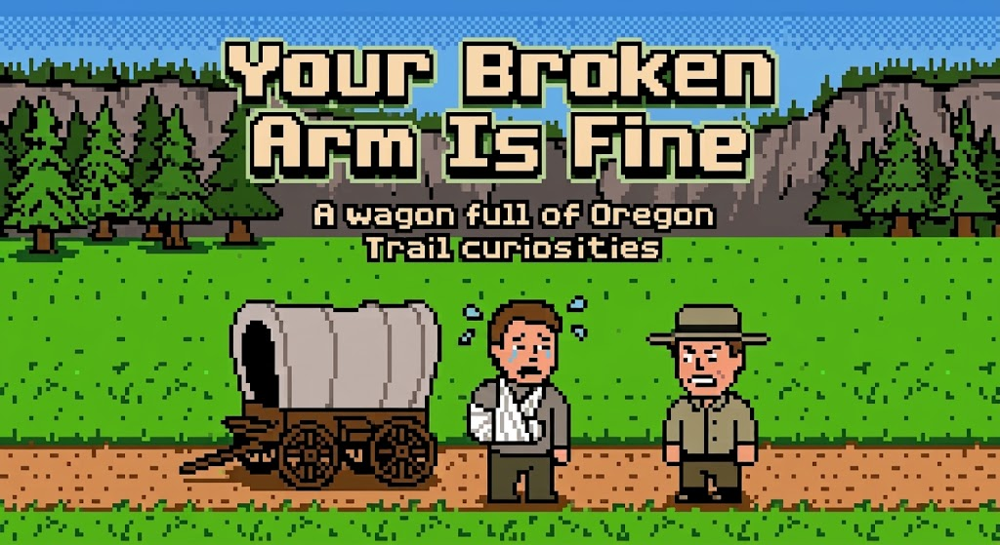

# Your Broken Arm Is Fine: A wagon full of Oregon Trail curiosities

By Giacomo Paganelli - rift-demote-fence@duck.com

## Myths and design
1. **Nobody dies of dysentery in this game.** The famous line "You have died of dysentery" does not exist in the game. The game says "[name] has dysentery" in one place and "[name] has died" in another, and it never puts the two together. As far as the game is concerned, your party members die of mysterious causes, and the dysentery is just a coincidence.
2. **There's no separate formula for dying.** If someone catches a second disease before they've recovered from the first, they die, and the second disease is never mentioned. The lead designer chose this to keep the game simple, and it means poor health costs you more lives. Nobody is told which disease finished them off.
3. **The river rules come from the size of a real wagon.** A wagon has about 30 inches of clearance, which is why you can only ford a river up to 2.5 feet deep. The Indian guide first cut the risks by only 50%, but testers kept having accidents anyway and decided he wasn't worth his fee. The developers made him much more reliable, cutting the risks by 80%.
4. **There's a secret menu for teachers.** Press Control-A at the title menu and you get a management screen where a teacher can reset the top ten (option 3) and erase embarrassing gravestones written by naughty kids. Nothing on the menu tells you it's there, and you can't remove a single name, only the whole list.
5. **You can shoot a bison, but you can't carry it home.** A bison weighs 1,700 to 2,000 pounds, but the game lets you bring back at most 100 pounds per hunt. The lead designer wanted to keep the wagon's load believable and make players think twice about wasting meat.
6. **The game only remembers two gravestones.** Ten would have interrupted play too often, so there's one grave per disk side, and a new one replaces the old.
7. **Children got good at hunting fast.** Adults found the hunting game too hard, and the lead designer kept it that way on purpose. Durint the testing, many children became keen hunters after only three or four tries.

## Odd corners and bugs
8. **A broken arm does nothing.** The game numbers injuries and illnesses, and the broken arm is number 0, which is also the number for "healthy". So the game thinks the person is fine even with a broken arm!
9. **Thieves never take your money.** The code does have a branch for stealing cash, but the thing a thief can pick is never the cash item, so it never happens. And if a thief finds nothing to take, the game shows no message at all.
10. **February always has 28 days.** That's true even in 1848, which was a leap year.
11. **If you have exactly the Barlow Road toll, you can't pay it.** The game checks that you have more than the toll, so a party with exactly enough money for the toll is told nothing and sent back to choose again. A single cent more and the road opens. Why?
12. **The final screen gets the century wrong after 1899.** It prints the year as "18" followed by a stored number, so 1905 appears as 18105.
13. **Waiting at a river is completely safe.** Nobody falls ill or dies while the party waits, however long it takes. A researcher once made a party wait 14,272 game years, which is a very patient wagon. When it finally crossed, it was in such bad shape that it died within days.
14. **The game crashes if the year goes past 2055.** The game stores the year in a single byte, which overflows, and the game stops with "Error 53 at line #50050".
15. **The game has climate data for Portland, but it's never used.** The code can only reach five climate zones, numbered 0 to 4, so the sixth row, for Portland, is never read. Sorry Portland!
16. **The first disk side is completely full, but the second has a leftover.** Side 1 has no free space at all. Side 2, however, still holds a developer's test program for the rafting game, which the game never runs.
17. **The hunting game has an "initialise" command that does nothing.** The machine-code package has a command called IHUNT, and its entry is a jump straight to a return. The BASIC never calls it, and everything is set up each time you start a hunt. We checked by running the hunting routine in an emulator: with no key pressed it always ends after exactly 2,500 passes.

## Numbers, numbers, numbers
18. **The whole game comes down to one number between 0 and 65,535.** The game counts quietly while it waits for you to press a key, and that count decides the luck in your game. However, some numbers give the same game as another number, so instead of 65,536 different games there are effectively only 62,883.
19. **Hunting has its own luck.** The hunting scene uses a separate random number generator, seeded from how long you took at earlier key presses. So even with the same starting number, a game with a hunt can't be replayed exactly.
20. **Even tiny rounding differences change the game.** In our experiment, using ordinary computer arithmetic instead of the original game's arithmetic changed the course of 55% of the games. It also made the game slightly harder: 22.73% of parties reached Oregon, against 22.86% with the original arithmetic. That was with a fixed start and a player who never made decisions, so it says nothing about a typical human game. A rounding error of a few decimal places can be the difference between Oregon and a gravestone.
21. **The weather table is written in inches of rain.** Each rain value in the table is 30 plus ten times the month's average rainfall in inches, so Kansas City's 4.8 inches of rain in June is stored as 78. But the game rolls the dice every day, and a simulated month gives only about a third (0.34) of that rain by my calculation.
22. **Nobody can score less than 250.** A lone banker in very poor health, with nothing left but the wagon itself, scores exactly 250. That is Elijah White's score at the bottom of the original top ten, and a tie doesn't count, so this lowest party doesn't make the list. Add one ox and it's 254, and you do.
23. **A hunter is as likely to meet a rabbit as a bison.** Each new animal is drawn evenly from the kinds allowed at that point on the trail. And an animal turns up at an attempt only about once in 125 tries.

## Differences from the lead designer's book
R. Philip Bouchard's amazing book "[You Have Died of Dysentery: The creation of The Oregon Trail – the iconic educational game of the 1980s](https://www.amazon.com/gp/product/B01B8JMKMC)" describes how the game was designed. A design as intended and a program as shipped always drift a little in a project this size, and there some places where they did. Nothing here is a criticism of the book! On the contrary, it was fundamental to progress with my paper (and also a great read which I highly recommend).

24. **Falling ill is gentler in the game than in the notes.** The book gives the daily chance of illness as 0% to 40%, depending on health. The shipped code gives 1% to 10.3%. Luckily for the party, the program is kinder.
25. **Several things can happen on the same day.** The book describes at most one random event a day. In the code the fifteen events are tested one after another and the loop doesn't stop at the first one that happens, so it can rain, break a wheel and bring a fever on the same Tuesday.
26. **The trail is kinder than the notes, and one breakdown is not on the list.** For losing the trail, fires and strays, and abandoned wagons or thieves, the book's rates add up to 11% a day. The code adds up to 5%. And breakdown of a wagon wheel, axle or tongue, which is a third of the code's 4% (7% in the mountains) breakdown-and-injury event, is not in the book's list of events.
27. **The game remembers which disease you have.** The book says the program doesn't keep track of which disease a person has. It does: the number is stored for the whole illness. It is just never shown to you, which may be what the book means.
28. **You flip the disk after a third of the trail, not halfway.** The disk flip comes at Fort Laramie, 640 miles in, which is about 34% of the 1,871-mile route by the Barlow Road. The book says "about halfway".
29. **The book asked a question, and the code answers it.** The designer wondered whether the frequency weighting of animals (common ones more likely) ever made it into the game. It didn't: the draw is even.
