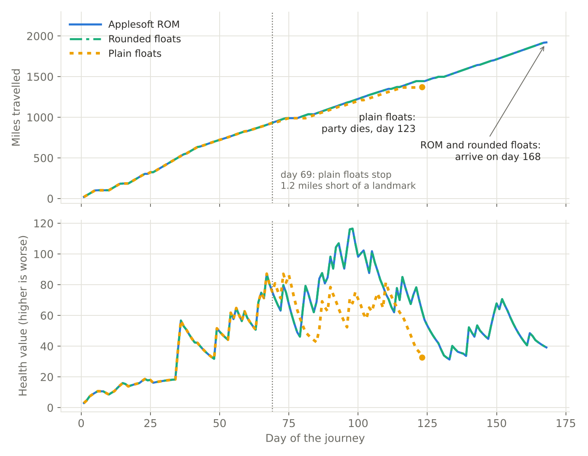
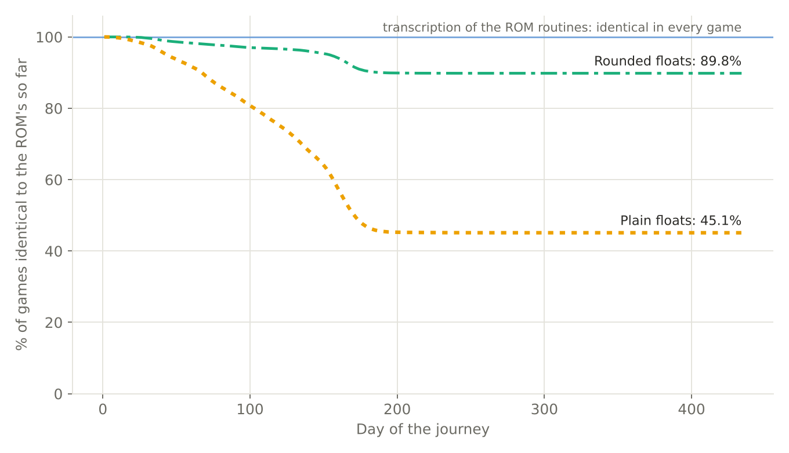
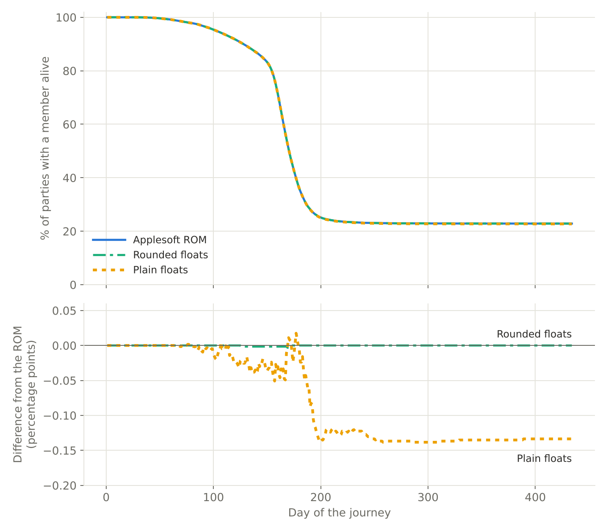
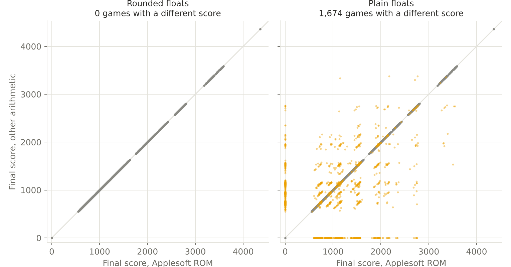
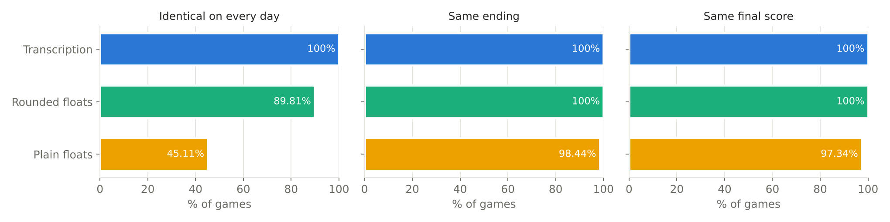

# The Oregon Trail on the Apple II (1985): An Analysis of Source, Data and Algorithms for Replication in Other Languages

by Giacomo Paganelli - rift-demote-fence@duck.com

Published 12 October 2026

**Abstract:** This paper documents the game logic of The Oregon Trail, the 1985 Apple II release by MECC, in enough detail to rebuild it in another language. Drawing on the original Applesoft BASIC listings, part of the machine code, the game's data files, the lead designer's book and a published study of the game, it gives every state variable, formula, probability and data table, each with the program line that defines it: set-up, supplies, travel, health, weather, random events, rivers, hunting, rafting and scoring. The movement and graphics code of the hunting game and the machine-code routines of the raft game were not decoded (section 1.4). It also sets the designer's account of the mechanics against the code and lists where they differ. It then asks what a replica needs in order to pass through exactly the same states as the original. The answer is Applesoft's own arithmetic: the ROM's routines, run in an emulator or transcribed instruction by instruction. An experiment over all 65,536 seeds, from one start and played by a fixed program, compares this arithmetic with simpler ones. A Python transcription of the ROM routines matched every game. Host 64-bit arithmetic rounded to Applesoft's precision ended every game the same way, with the same score, though one game in ten differed in a last digit along the way; without the rounding, 55% of the games took a different course and 1.6% ended differently. A Python rebuild using the ROM's arithmetic agreed with the original, running in an emulator, on every logged value of every day of two games.

**Keywords:** The Oregon Trail; MECC; Apple II; Applesoft BASIC; 6502; game preservation; software archaeology; algorithm analysis; emulation; floating-point arithmetic; educational software

## 1. Introduction

### 1.1 Historical context

The Oregon Trail began in 1971 as a text game written in two weeks by Don Rawitsch, Bill Heinemann and Paul Dillenberger for a Minneapolis history class. It ran in HP Time-Shared BASIC on an HP 2100 minicomputer reached by teleprinter. Rawitsch joined the Minnesota Educational Computing Consortium (MECC) in 1974, typed the program in again, and MECC released it on its timeshare network in 1975. An Apple II version followed in 1980 in the collection Elementary Volume 6 (“The Oregon Trail (1971 video game),” n.d.).

The version analysed here is the redesign made between October 1984 and July 1985 and released for the Apple II in 1985 (Minnesota Educational Computing Consortium \[MECC\], 1985). R. Philip Bouchard was lead designer, John Krenz lead programmer and Charolyn Kapplinger the artist, with Shirley Keran (research), Bob Granvin (programming), Roger Shimada (assembly language, the hunting game) and Steve Splinter (the rafting game) (Bouchard, 2016; “The Oregon Trail (1985 video game),” n.d.). The program headers name Krenz as programmer of the main modules and Splinter as programmer of `FLOAT`.

The redesign replaced the two-week turns of the 1971 original with a daily simulation along a chain of eighteen landmarks, and added river crossings, trading, hunting and rafting games, tombstones and a scored ending. One popular belief needs correcting: the phrase "You have died of dysentery" does not appear in this game. The program prints "\[name\] has dysentery." and, separately, "\[name\] has died." When a member of the party dies, it never states the cause, as the designer's book confirms (Bouchard, 2016). Causes of death are named only in text that is not about the party: a remark to the player on the title menu ("you die of cholera", `MENU` 7041) and one of the dialogue records.

### 1.2 Objective

The objective of this paper is to document the game's algorithms exactly enough to replicate them: every state variable, formula, probability and data table, with the program line that defines it. A second objective is to state what is required for algorithmic parity, meaning that a replica given the same random seed and the same player inputs passes through the same internal states as the original. Section 12 shows that this second goal cannot be met by translating the BASIC into another language and using that language's own arithmetic: the arithmetic must be Applesoft's as well, either the ROM's own routines or an exact transcription of them. However, a replica that needs only to play the same game, rather than pass through the same states, does not need algorithmic parity: with every result rounded to Applesoft's precision, every game in the experiment of section 12.7 ended as under the ROM, with the same score.

### 1.3 Sources and method

The primary source is the Applesoft BASIC source of release 1.4 (the management screen reads "Version 1.4", last update 87/02/24), read as text listings. Data that the programs load at run time, namely the landmark, segment, river, climate and illness tables, were decoded from the file `VAR.BIN`. The dialogue, high-score and tombstone files were read directly from disk.

Secondary sources are Bouchard's (2016) book on the game's design and a technical study of a long-wait exploit (moralrecordings, 2025). Where the book describes a design intention that the shipped code does not follow, this paper reports the code and notes the difference. The comparison was made in both directions: each statement the paper attributes to the book was looked up in the book, and each statement the book makes about how the 1985 game works was set against the listings (section 1.5). Details of the Applesoft interpreter come from the published commented disassembly of its ROM (“Applesoft BASIC,” n.d.; McFadden, n.d.; Sander-Cederlof, n.d.).

The game's own 6502 machine code (the `&` command package and the hunting routine) was disassembled and analysed with the assistance of an AI model, Anthropic Claude Opus 5.5 (High). The findings in section 11.1 and Appendix E come from that analysis. They are a static reading of the code. The hunting routine's logic was also run under a 6502 emulator, with the hardware stubbed, and the results of section 11.1 that the run could test were confirmed (section 11.1, "Execution check"). The rest of the `&` package was not run.

Two AI models assisted with the analysis of the BASIC source: Google Gemini 3.1 Pro (Extended Thinking), and Anthropic Claude Opus 5.5 (High). Both models were also used to assist with the analysis of the data files, the checking of sources, and the drafting and editing of the text of this paper. The author directed the work, wrote the earlier versions of the paper, revised the text by hand alongside the models' revisions, prepared the final version, and is responsible for its content.

A line number without a program name refers to the program named in the section heading or, if the heading names none, to `OREGON TRAIL`. Program names are written as they appear on disk: `MENU`, `BUY SUPPLIES`, `OREGON TRAIL`, `FLOAT`, `WIN`, and the libraries `RIVER.LIB`, `TRADE.LIB` and so on.

The source code is not reproduced in this paper because it remains under copyright and cannot be distributed. A reader can obtain the same listings by extracting the BASIC programs, along with any other file, from the game's disks with CiderPress II (<https://ciderpress2.com/>). Readers who do so act under their own responsibility, not the author's. For this paper the listings were extracted in that way, and the game was run in the emulator AppleWin (<https://github.com/AppleWin/AppleWin>), both unchanged and with copies of its BASIC programs modified to run faster and to show internal values, in order to gather data and observe its behaviour. The measurements in section 12 were made with a Python rebuild of the game, not with the original (section 12.6).

### 1.4 Limits of this analysis

The machine-language routines reached through the `&` command were disassembled from the system tracks of the release 1.4 disk and read at their entry points, which establishes their argument lists and general function (Appendix E). The hunting routine was analysed in more depth (section 11.1), though its graphics and movement code were not. The routines used only by the river-floating program, and the image and tune data formats, were not decoded, and the packed-picture format was read from its loader only. Apart from running the whole game in an emulator, the only machine code of the game that was executed is the hunting routine, run under a 6502 emulator with the Apple II hardware stubbed (section 11.1); the rest of the `&` package was read, not run. The claims in section 12 about the interpreter's arithmetic rest on the published ROM disassembly (Sander-Cederlof, n.d.) and were tested by executing the ROM's arithmetic routines and random number generator under a 6502 emulator (section 12.6). Two games were recorded day by day from the original running in an emulator and compared with the rebuild (section 12.6 and Appendix G).

### 1.5 Design intentions behind the mechanics

The designer's book (Bouchard, 2016) explains why each mechanic exists. These reasons help those who want to replicate the game to determine which details matter. All statements in this subsection are the book's.

**Table 1.** Design reasoning behind each game mechanic, as given in the designer's book.

| Mechanic                          | Design reasoning                                                                                                                                                                                                                                                                                                                                                                                                                                 |
| --------------------------------- | ------------------------------------------------------------------------------------------------------------------------------------------------------------------------------------------------------------------------------------------------------------------------------------------------------------------------------------------------------------------------------------------------------------------------------------------------ |
| Two nested cycles                 | Bouchard wanted the real geography of the trail, so the journey became a chain of landmarks, "like beads on a string", with most activities attached to them. He did not want to jump from landmark to landmark, because supplies can run out and incidents happen in between. He therefore added a daily cycle inside the landmark cycle, "a cycle within a cycle", in which speed, location and the state of the party are computed every day. |
| Automatic travel with an override | Asking the player what to do every day would mean about 150 halts in a five-month journey. Travel therefore runs by itself, and the player can interrupt it at any time.                                                                                                                                                                                                                                                                         |
| Professions                       | The three difficulty levels differ only in starting cash. The team chose to present them as occupations; the middle one was a shopkeeper in the alpha version and became a carpenter.                                                                                                                                                                                                                                                            |
| Departure month                   | In the original game every trip began on the same date. For real emigrants, leaving too early meant snow and no grass, and leaving too late meant snow in the mountains. Giving the player this choice is what made a climate model necessary.                                                                                                                                                                                                       |
| Climate model                     | The aim was realistic temperature and rainfall for the place and season from the simplest workable model: zones based on present-day climate data for towns near the trail.                                                                                                                                                                                                                                                                      |
| Cutoffs                           | Three real cutoffs were kept: the Sublette Cutoff past Fort Bridger, the route past Fort Walla Walla, and the Barlow Toll Road past the Columbia gorge. Skipping a fort saves days but loses the chance to buy.                                                                                                                                                                                                                                  |
| Death by second illness           | A person dies on catching a second disease before recovering from the first, and the second disease is never reported. This removed the need for a separate death formula, tied the death rate to general health, and avoided tracking several diseases per person.                                                                                                                                                                              |
| Disease names                     | "Heat exhaustion" and "mountain fever" became "exhaustion" and "a fever" after testers found them odd in cool weather or on the plains.                                                                                                                                                                                                                                                                                                          |
| River crossings                   | A wagon has about 30 inches of clearance, hence the 2.5-foot fording limit. An early draft had a second break point at 5 feet; it was replaced by losses that rise smoothly with depth.                                                                                                                                                                                                                                                          |
| Indian guide                      | The guide first halved the risks. Testers still had accidents and judged the guide useless, so the reduction was raised to 80%.                                                                                                                                                                                                                                                                                                                  |
| Meat limit                        | Bouchard wanted to show the difference between small and large game, to make players reflect on wasteful hunting, and to keep the wagon's load plausible. He settled on 100 pounds carried back per hunt after trying other values.                                                                                                                                                                                                              |
| Hunting difficulty                | Adults found hunting too hard. Bouchard kept it, reasoning that a first-time hunter is not an expert, and observed in testing that many children developed a keen proficiency quite quickly, sometimes after only three or four hunts.                                                                                                                                                                                                                                                                    |
| Tombstones                        | Ten saved gravestones would have interrupted play too often. Two were approved, one on each side of the disk, with the newest replacing the old one.                                                                                                                                                                                                                                                                                             |
| Scoring                           | No score is shown unless the party reaches Oregon, so that a new player concentrates on survival. Survivors count most, then their health, then goods and cash. A multiplier for the harder professions allowed a single high-score list, which also suited the limited disk space.                                                                                                                                                              |

Bouchard (2016) also describes the mechanics as designed. The shipped code differs from his description in the places listed in Tables 2 and 2a, and a replica of the game should follow the code. The first table covers the health model; the second covers everything else. Each row gives the section that holds the code's rule.

**Table 2.** Differences between the book's description of the health model and the shipped code.

| Item                               | Book's description                      | Shipped code                                       |
| ---------------------------------- | --------------------------------------- | -------------------------------------------------- |
| Daily chance of illness            | 0% to 40%, by health                    | 1% to 10.3% (section 5.3)                          |
| Penalty with no food               | add 6                                   | add 8 (section 5.1)                                |
| Clothing needed to avoid a penalty | 2 sets a person in cold, 4 in very cold | 3 in cold, 5 in very cold, 1 in cool (section 5.1) |
| Climate zones                      | six, the last based on Portland         | five; the Portland row is never read (section 6.1) |
| Temperature penalty in cold weather | cold: 0 with 2 or more sets of clothing a person, 2 with none; very cold: 0 with 4 sets, 4 with none | the clothing term `ZC` as above, and in addition `ZT` adds 1 in cold and 2 in very cold whatever the party wears (section 5.1) |
| Rain and snow                      | not part of the health list             | `ZP` adds 1 in rain or snow and 2 in heavy rain or snow (section 5.1) |
| Memory of the illness              | the program does not remember which disease a person has | `H1(n)` holds the disease number for the whole illness; it is never displayed (section 5.3) |
| Injury and disease                 | tracked separately                      | one slot, `H1`/`H2`; a broken arm is number 0, which means healthy, so it has no effect (section 13) |

**Table 2a.** Differences between the book's description of the other mechanics and the shipped code.

| Item | Book's description | Shipped code |
| --- | --- | --- |
| Events in one day | no more than one | the loop goes on after an event unless `B` is above zero, so several can fire on one day (section 8.1) |
| Lose trail or wrong trail | 2% and 1% | 2% in all, half each (section 8.2) |
| Fire, lost member, stray ox | 2%, 1% and 1% | 1% in all, in equal thirds (section 8.2) |
| Abandoned wagon, thief | 2% and 2% | 2% in all, half each (section 8.2) |
| Ox injured or dead, person injured | 2% each on the prairie, 3.5% each in the mountains; no wagon part in the list | one event of 4%, or 7% in zones 3 and 4. A third breaks a wagon part, and the rest is split between ox and person: each 1.34% (2.35% in zones 3 and 4), the part 1.32% (2.31%) (section 8.2) |
| Snake bite | 0.7% | 0.7%, but only in warm weather or hotter (section 8.2) |
| Fog and hail | fog after Fort Hall, hail before it | the switch is at landmark 12, the Snake River crossing (section 8.2) |
| Random events listed | fifteen random events | the code also has snow bound, certain once snow exceeds 30, and the gravesite, which are not random draws (section 8.2) |
| Mountain travel | half speed in the mountains; rough and impassable trail, 2.5% each, only there | the speed base falls from 20 to 12 miles a day at Fort Laramie, a factor of 0.6 not 0.5, and is set per segment; rough and impassable trail begin in zone 3, at Fort Hall (sections 4.4 and 8.2) |
| Snow when cold | 8 inches (heavy) and 2 inches (light) | 6.4 and 1.6 (section 6.3) |
| Snow melting | 3% a day only in very cold, cold or cool weather without heavy rain | 3% a day in every kind of weather, and 5 units also melt in warm or hotter weather or when very rainy (section 6.4) |
| Snow and speed | up to 100% slower | `1 - AS / 40`, so zero at 40; the snow-bound event starts above 30 (sections 4.5 and 6.4) |
| Ferry wait | 1 to 6 days | 2 to 6 days (section 9.3) |
| Goods lost in a ford | "0% to 40%" at 4 feet, up to 80% at 8 feet | each good is lost with chance depth/10, and then `INT (RND * X + 1)` of it, so up to all of it; the mean is the same, the spread wider (section 9.3) |
| Raft hits | hitting the bank costs even more than hitting a rock | per hit the rock costs more (Table 25); the book may mean how often the bank is hit |
| Hunting terrain | four to six objects, one to three kinds a zone, six kinds | 4 to 7, one or two kinds, five kinds (section 11.1) |
| Distance and segments | 18 landmarks, 20 segments, 16 on the main route | 18 landmarks and 19 segments in Table 8, 16 on the main route, 15 if Fort Walla Walla is bypassed; the book's twentieth is the raft trip, which is the program `FLOAT` (section 4.1) |
| Disk flip | once, "about halfway" | once, at Fort Laramie, 640 miles from the start, about 34% of the 1,871-mile route by the Barlow Road (section 2.1) |
| Default top ten | "Mary Barlett" | "Mary Bartlett" in the program's DATA lines (section 10.4) |
| Lowest score | anyone who reaches Oregon beats Elijah White (250) | the lowest possible score is 250, which ties him and is not inserted (section 10.4) |

The reverse check set 119 statements of the book about the game against the paper and the listings. Eighty-four agree with the code, among them all nineteen segment mileages, the eighteen landmarks, the ford, float, ferry and guide thresholds, the prices at Matt's store, the starting money for each profession, the rations and pace terms, the range of points a survivor is worth, the management-menu numbers and the tombstone rules. Seven agree in part, eighteen differ (Tables 2 and 2a), nine are consistent with the code but cannot be proved by it, and one cannot be tested. The check covers what can be tested from the listings. It cannot test graphics, wording, timings, the design history or anything about the earlier versions. The book was read line by line from the framework chapter to the end of Chapter 19, and Appendix 2 in full; the earlier chapters and Appendices 1, 3 and 4 were searched for rules and numbers but not read in full, so a rule stated only there could have been missed.

## 2. Architecture and data flow

### 2.1 Programs and libraries

The game is six chained BASIC programs, each loaded when needed, plus fifteen small BASIC libraries; together they would not fit in memory at once. They are spread over two disk sides because side 1 is full. The player flips the disk on reaching Fort Laramie (line 1016), 640 miles from the start, about 34% of the 1,871-mile route by the Barlow Road, so the flip comes earlier than the book's "about halfway"; `OREGON TRAIL` stays in memory and carries on from side 2. Each side also holds a short start-up program, `HELLO`. Side 1's loads the `&` machine-language package (Appendix E). Side 2's tells the player that this is side 2 and restarts the machine, so the game cannot be started from the wrong side. Side 2 also holds a second `MENU`, run when the game returns to the menu with side 2 in the drive, which asks for side 1 and runs the title menu, and a test program for the rafting game that the game itself never runs.

**Table 3.** Programs and libraries, with disk side and role.

| Program        | Side | Role                                                                                           |
| -------------- | ---- | ---------------------------------------------------------------------------------------------- |
| `MENU`         | 1    | Title menu, profession, party names, top ten, random seed                                      |
| `MANAGEMENT`   | 1    | Teacher options: view or reset the top ten, erase tombstones                                   |
| `BUY SUPPLIES` | 1    | Departure month and Matt's General Store                                                       |
| `OREGON TRAIL` | 1    | The journey: landmarks, daily cycle, events, menus; it keeps running after the disk is flipped |
| `FLOAT`        | 2    | Columbia River rafting game                                                                    |
| `WIN`          | 2    | Scoring and top-ten entry                                                                      |

The libraries are `COMMON.LIB` (input, error handling, disk checks), `RIVER.LIB`, `CROSS.LIB`, `BUY.LIB`, `TRADE.LIB`, `TALK.LIB`, `HUNT.LIB`, `MAP.LIB`, `PACE.LIB`, `RATION.LIB`, `PART.LIB`, `LF.LIB` (fire, abandoned wagon, thief), `TOMB.LIB`, `END.LIB` and `FLIP.LIB`. 
`COMMON.LIB` occupies lines 30000 to 41100; each program appends it at line 100 and it stays.
`PART.LIB` occupies lines 42000 to 42900 and is called with `GOSUB 42000` and removed with `& DBL,42000,42900` (line 10800).
Every other library occupies lines 50000 upward: `OREGON TRAIL` appends it with `& APP`, calls it with `GOSUB 50000`, then removes it with `& DBL,50000,60000`.
Because a library runs inside the main program, it shares all of its variables.

The `&` commands are machine-language extensions for graphics, windows, input, disk files and program chaining. `& RNH` runs another program; `& RFL` loads a binary file at an address; `& OPEN`, `& TPTR`, `& TREED` and `& TWRITE` read and write text files at a byte offset. Appendix E lists every command with the arguments and behaviour read from a disassembly of the package.

### 2.2 The saved variable table

`OREGON TRAIL` does not build its data tables with DATA statements. Line 100 sets `LOMEM: 39170`, loads the file `VAR.BIN` at 39170 and loads `PT.BIN` at address 105, the interpreter's variable pointers. Together these restore a complete, pre-built variable table: the constants `C0` to `C4` and `P5`, the landmark and segment arrays, river data, climate strings, illness names and all menu text. A replica must take its data from `VAR.BIN`; the tables are reproduced in sections 4, 6, 8 and 9.

### 2.3 State passed between programs

Running a new program clears all BASIC variables, so state is passed in memory locations 900 to 917 with POKE and PEEK, and party names as zero-terminated ASCII from address 1920. Values above 255 are split with `FN HI(Z) = INT (Z / 256)` and `FN LO(Z) = Z - FN HI(Z) * 256`.

There are two different layouts, one at the start of the journey and one at the end of the journey, and they must not be confused.

**Table 4.** Memory addresses used to pass state between programs, at the start and end of the journey.

| Address | Start of journey (written by `MENU` and `BUY SUPPLIES`) | End of journey (written by `END.LIB` and `FLOAT`) |
| --- | --- | --- |
| 900 | not written; party size 5 comes from `VAR.BIN` | people alive (NP) |
| 901 | 48 | year minus 1800 |
| 902 | month (3 to 7) | month |
| 903 | day (1) | day |
| 904 | wagon flag (1) | bullets, low byte |
| 905 | yokes of oxen | bullets, high byte |
| 906, 907 | pounds of food, low and high | pounds of food, low and high |
| 908 | sets of clothing | sets of clothing |
| 909 | boxes of bullets | oxen, as `I(2) + .5` |
| 910, 911, 912 | spare wheels, axles, tongues | spare wheels, axles, tongues |
| 913, 914 | money times 10, low and high | whole dollars, low and high |
| 915 | profession (1 banker, 2 carpenter, 3 farmer) | unchanged |
| 916 | not used | health band, `INT (H / 35)` |
| 917 | not used | cents, `(MY - INT (MY)) * 100 + .5` |

There are other fixed locations: 919 is a flag the error handler reads to decide how to treat Control-C; 975 holds the sound setting; 955 is a disk-configuration flag tested before asking the player to flip the disk.

### 2.4 Error handling

Every program sets `ONERR GOTO 32000`. The handler reads the error code from address 222 and the line number from 218 and 219, resumes after disk errors 1 to 15, and otherwise prints "Error \[code\] at line #\[line\] in \[program\]. Please report this error to MECC." The codes are Applesoft's own. Code 53 is ILLEGAL QUANTITY, which is what a POKE of a value above 255 produces (see section 13).

### 2.5 Applesoft rules that a replica must follow

Several rules of the Applesoft language differ from those of modern languages. A replica that overlooks any of them will read the listings wrongly, and the errors are easy to miss because the result still looks plausible.

- **Everything after `THEN` belongs to the `IF`.** When the condition is false, the rest of the line is skipped, including a second `IF` and every statement after it. Line 3180 ends `IF B > 0 THEN GOSUB 4000: GOSUB 300:L8 = 20`, so `L8 = 20` runs only when an event has fired and `B` is above zero (section 8.1). Line 1015 ends `IF Z = 3 THEN GOSUB 4200: GOSUB 190: GOTO 1015`, so the `GOTO` is taken only after the map has been shown. In line 4040 the "Buy supplies" entry is nested inside `IF NOT LL`, so it is offered only at a landmark, never on the trail.
- **A simple variable and an array of the same name are different variables.** `Q` and `Q(0 to 16)`, `B` and `B(0 to 5)`, `RE` and `RE(0 to 14)`, `RC` and `RC(...)`, and `Z` and `Z(...)` are each two separate things. When `BUY.LIB` sets `Q` to the fort's price tier, the landmark history in `Q()` is not touched, and when `RIVER.LIB` sets `RC` to the river's number, the base data in `RC()` is not touched.
- **A `FOR` loop always runs its body at least once.** The limit is tested at `NEXT`, not at the start, so `FOR A = 0 TO NR` with `NR` equal to -1 still runs once with `A` equal to 0. With a fractional limit, `FOR L = 1 TO 5.5` runs five times and `FOR L = 1 TO 0.5` runs once.
- **`AND` and `OR` evaluate both sides.** There is no short-circuit, so a `RND` call on the right-hand side always happens (Appendix F).
- **A comparison is a number**, 1 for true and 0 for false, and the listings use it in arithmetic throughout. `NOT`, `AND` and `OR` follow the same rule: they test their operands for zero and return 1 or 0 (ROM at DE98 and DF4F to DF62). Unlike the bitwise operators of some other Microsoft BASICs, `NOT 0` is 1, not -1, which is what `FN W` (section 6.2) relies on.
- **`ON n GOSUB` does nothing when `n` is 0 or exceeds the number of targets.** The listings use this as a conditional call, as in `ON B > 0 GOSUB 4000`.
- **A subroutine runs on through the following lines until it meets `RETURN`.** `TOMB.LIB` 50000 has none, so a call to it continues into line 50005.
- **`INT` rounds down**, so `INT` of -2.7 is -3, and **string positions in `MID$` count from 1.**

## 3. Game setup

### 3.1 Main menu and the random seed (`MENU`, lines 1000 to 1020)

The menu offers four choices: travel the trail, learn about the trail, see the top ten, and turn sound on or off. Control-A opens the management program, a hidden feature meant to be used by teachers. Its menu line 1015 (`ON Z GOSUB 900,900,700,200,31000`) dispatches by number; option 3 resets the top ten to the original list and option 4 blanks the tombstones on both disk sides. A single name cannot be removed, as the book says. Immediately after the player's keypress, line 1015 reseeds the random generator:

`Z = RND ( - ( PEEK (78) + PEEK (79) * 256))`

Locations 78 and 79 are a 16-bit counter that is incremented while the program waits for a key, by the system's keyboard routine and by the waiting loops of the `&` package (Appendix E). Nothing in the game resets it, so it accumulates over every wait from the moment the machine is started, wrapping at 65,536. The seed is therefore one of at most 65,536 values, fixed by the total time spent waiting for keys. A count of 0 gives `RND (0)`, which repeats the last value and does not reseed. This is the only reseeding in the game. A replica that takes this 16-bit value and the player's inputs can replay any game without a hunt. The hunting routine seeds its own generator from the same counter at the start of each hunt, and its outcome depends on the player's timing (section 11.1).

### 3.2 Profession and money (`MENU`, lines 4000 to 4030)

The player chooses banker, carpenter or farmer. Line 4030 stores the choice at 915 and the starting money, times ten, at 913 and 914:

`Z = ((Z = 1) * 1600 + (Z = 2) * 800 + (Z = 3) * 400) * 10`

In Applesoft a true comparison has the value 1 and a false one 0, so this yields $1,600, $800 or $400. Money is stored times ten because the hand-over uses whole numbers.

### 3.3 Party names (`MENU`, lines 6000 to 6045)

Ten default names (Zeke, Jed, Anna, Mary, Joey, Beth, John, Sara, Henry, Emily) are placed in random order. For each name the program draws `INT (RND (1) * 10)` and, if that slot is taken, steps forward to the next free slot, wrapping from 9 to 0. The number of random draws is always ten, but the resulting order depends on them. The player then types the leader's name, which cannot be left blank, and up to four others. A blank answer for one of the four keeps the shuffled defaults for that member and every later one, and ends the entry (line 6030); any single name can then be changed (line 6041). Line 6045 writes the five names from address 1920, each ended by a zero byte.

### 3.4 Departure month (`BUY SUPPLIES`, lines 6000 to 6030)

The year is fixed at 1848 (`MENU` 9000 stores 48 at 901). The player picks March to July as options 1 to 5; line 6030 stores the option plus 2 at 902, and the day is set to 1.

### 3.5 Matt's General Store (`BUY SUPPLIES`, lines 400 to 5020)

**Table 5.** Items sold at Matt's General Store, with prices, input limits and storage addresses.

| Item                         | Price                  | Input limit        | Stored at     |
| ---------------------------- | ---------------------- | ------------------ | ------------- |
| Oxen                         | $40 a yoke (2 oxen)    | 1 to 9 yoke        | 905           |
| Food                         | $0.20 a pound          | up to 2,000 pounds | 906, 907      |
| Clothing                     | $10 a set              | up to 99 sets      | 908           |
| Ammunition                   | $2 a box of 20 bullets | up to 99 boxes     | 909           |
| Spare wheels, axles, tongues | $10 each               | up to 3 of each    | 910, 911, 912 |

The bill is the sum of the five lines (line 4000). The player cannot leave if the bill exceeds the money held (line 5000) or with no oxen (line 5006). On leaving, line 5010 stores the remaining money times ten:

`MY = (MY - TB) * 10: POKE 913, FN LO(MY): POKE 914, FN HI(MY)`

Amounts are shown through the rounding routine at line 200, `V = INT (V * 100 + .5)`, which rounds to the nearest cent before the digits are cut into dollars and cents. The same routine appears in `OREGON TRAIL` (line 200) and `WIN` (line 250).

### 3.6 Initial state of the journey (`OREGON TRAIL`, lines 29000 to 29020)

On loading, the main program reads the hand-over values and sets its starting state.

**Table 6.** Initial values of the main program's variables at the start of the journey.

| Variable | Initial value |
| --- | --- |
| Money `MY` | (PEEK(913) + PEEK(914) \* 256) / 10 |
| Oxen `I(2)` | 2 times the yokes |
| Bullets `I(4)` | 20 times the boxes |
| Food `I(8)` and `PF` | the pounds bought |
| People `NP`, pace `P`, rations `R`, health `H` | 5, 1 (steady), 1 (filling), 0, from `VAR.BIN` |
| Snow on the ground `AS` | `RND (1) * 12` if leaving in March, else 0 |
| Accumulated rain `AR` | `7 - month + RND (1)` |
| Weather `W` and `TM` | `INT (( FN W(0) + 10) / 20)`, the class of the month's minimum temperature |
| Fixed event chances | see section 8 |

The two `RND` calls on lines 29000 and 29004 are the first of the journey, in that order.

Line 29000 also computes the first weather class with `FN W(0)`. At that point the zone variable `ZO` has not yet been set by line 1000, and it is not among the values restored from `VAR.BIN` (Appendix D), so it is 0. The first weather class is therefore taken from climate row 0 for the departure month.

## 4. Landmarks, segments and the daily travel cycle

### 4.1 Two tables: landmarks and segments

The trail is held in two arrays that are indexed differently. `LM$(0 to 17, 0 to 3)` describes the 18 landmarks. `LM(0 to 18, 0 to 2)` describes the 19 trail segments. A landmark names the segment or segments that leave it; a segment names the landmark it ends at.

**Table 7.** The 18 landmarks, with type and outgoing segments.

| No. | Landmark `LM$(n,0)` | Type `LM$(n,1)` | Segment out `LM$(n,2)` | Second segment `LM$(n,3)` |
| --- | --- | --- | --- | --- |
| 0 | Independence | 1 | 0 | none |
| 1 | the Kansas River crossing | 2 | 1 | none |
| 2 | the Big Blue River crossing | 2 | 2 | none |
| 3 | Fort Kearney | 1 | 3 | none |
| 4 | Chimney Rock | 0 | 4 | none |
| 5 | Fort Laramie | 1 | 5 | none |
| 6 | Independence Rock | 0 | 6 | none |
| 7 | South Pass | 0 | 7 | 8 |
| 8 | Fort Bridger | 1 | 9 | none |
| 9 | Green River crossing | 2 | 10 | none |
| 10 | Soda Springs | 0 | 11 | none |
| 11 | Fort Hall | 1 | 12 | none |
| 12 | the Snake River crossing | 2 | 13 | none |
| 13 | Fort Boise | 1 | 14 | none |
| 14 | the Blue Mountains | 0 | 15 | 16 |
| 15 | Fort Walla Walla | 1 | 17 | none |
| 16 | The Dalles | 0 | 18 | none |
| 17 | the Willamette Valley | 0 | 99 | none |

Type 1 is a fort (buying allowed), type 2 a river crossing, type 0 neither. In the last column `none` stands for the stored value 0. The 99 in the last row lies outside the segment table, which runs from 0 to 18.

**Table 8.** The 19 trail segments, with miles, speed base, end landmark and route.

| Segment | Miles `LM(s,0)` | Speed base `LM(s,1)` | Ends at landmark `LM(s,2)` | Route |
| --- | --- | --- | --- | --- |
| 0 | 102 | 20 | 1 | Independence to Kansas River |
| 1 | 83 | 20 | 2 | Kansas River to Big Blue River |
| 2 | 119 | 20 | 3 | Big Blue River to Fort Kearney |
| 3 | 250 | 20 | 4 | Fort Kearney to Chimney Rock |
| 4 | 86 | 20 | 5 | Chimney Rock to Fort Laramie |
| 5 | 190 | 12 | 6 | Fort Laramie to Independence Rock |
| 6 | 102 | 12 | 7 | Independence Rock to South Pass |
| 7 | 57 | 12 | 9 | South Pass to Green River |
| 8 | 125 | 12 | 8 | South Pass to Fort Bridger |
| 9 | 162 | 12 | 10 | Fort Bridger to Soda Springs |
| 10 | 144 | 12 | 10 | Green River to Soda Springs |
| 11 | 57 | 12 | 11 | Soda Springs to Fort Hall |
| 12 | 182 | 12 | 12 | Fort Hall to Snake River |
| 13 | 114 | 12 | 13 | Snake River to Fort Boise |
| 14 | 160 | 12 | 14 | Fort Boise to Blue Mountains |
| 15 | 55 | 12 | 15 | Blue Mountains to Fort Walla Walla |
| 16 | 125 | 12 | 16 | Blue Mountains to The Dalles |
| 17 | 120 | 12 | 16 | Fort Walla Walla to The Dalles |
| 18 | 100 | 12 | 17 | The Dalles to Willamette Valley (Barlow Road) |

The shortest route, by Green River and straight to The Dalles, is 1,771 miles to The Dalles and 1,871 by the Barlow Road.

### 4.2 The landmark cycle (lines 1000 to 1020, 2100 to 2200)

1. On arrival, line 1000 draws `A = INT (RND (1) * 3)`, the first dialogue to offer, and sets the climate zone (section 6).
2. The player may look around, which opens the action menu (line 4000).
3. At a river landmark, line 1015 forces the crossing routine before departure (section 9.3).
4. At a landmark with a second segment, the player chooses a branch (line 2110). A third choice shows the map and then asks again (line 1015). At The Dalles the choice is made in `END.LIB` (section 10).
5. Line 2200 loads the chosen segment: `D = LM(Z,0)`, `MD = LM(Z,1)`, `NM = LM(Z,2)`.
6. Line 1016 then runs the segment from line 3000, whose daily cycle repeats until `D` is zero, and sets `LM = NM`. At landmark 17 the game ends.

### 4.3 The action menu (lines 4000 to 4900)

**Table 9.** Action menu options, with their effects and the days they use.

| Option | Effect | Days used |
| --- | --- | --- |
| Continue on trail | leaves the menu; refused with no oxen or an unreplaced broken part | 0 |
| Check supplies, look at map | display only | 0 |
| Change pace, change rations | sets `P` or `R` to 1, 2 or 3, then recalculates speed | 0 |
| Stop to rest | 1 to 9 days of the daily cycle with pace 0 and no travel | 1 to 9 |
| Attempt to trade | section 9.2 | 1 |
| Talk to people (at landmarks) | section 9.1 | 0 |
| Buy supplies (at forts) | section 9.4 | 0 |
| Hunt for food (on the trail) | section 11.1 | 1 |

### 4.4 Speed (lines 650 to 660)

`V = I(2) / 4: IF V > 1 THEN V = 1`

`FC = NP * (4 - R): BS = MD * V * (P + 1) / 2: OP = I(3) / NP: F0 = 2 * (R - 1)`

Base speed `BS` is the segment's speed base (20 miles a day before Fort Laramie, 12 after: a factor of 0.6, set segment by segment rather than by terrain; the book says half), scaled down if there are fewer than four oxen, and multiplied by 1, 1.5 or 2 for steady, strenuous or grueling pace. This routine also sets daily food use `FC`, clothing per person `OP` and the ration penalty `F0`. It runs at the start of a segment and after a change of pace or rations, a death, a trade, a theft or an ox injury. It does not run daily, so clothing lost in a fire or a river does not change `OP` until the next of those occasions.

### 4.5 The daily cycle (lines 3100 to 3499)

Each day runs in this fixed order. The order matters because it fixes the sequence of `RND` calls.

1. Read the month's base temperature `QT` and rain chance `QP`, and, unless the party is stopped, check the keyboard (line 3100, `GOSUB 800`): a Return opens the action menu (line 810), so a rest, trade or hunt can take place inside a travelling day.
2. Cap health at 139 (line 3150).
3. Set the day-dependent event chances, whether or not the party is stopped (line 3160). Then, unless the party is stopped, run the random-event loop and check the keyboard again (lines 3180 to 3190; section 8).
4. Count down illnesses and count the sick (line 3200; section 5).
5. Generate weather (lines 3205 to 3206; section 6).
6. Compute the health penalties, the starvation factor and health; eat (lines 3207 to 3230).
7. If health exceeds 139 and the party is not at a river, force an illness (line 3235).
8. Update accumulated rain and snow (line 3240).
9. Travel (lines 3244 to 3246): `Z = 1 - AS / 40`, not below 0, then `V = BS * (C1 - .1 * H0) * NOT SD * Z: IF 1.1 * V > D THEN V = D`, then `D = D - V: M = M + V`.
10. Cap health again, advance the date (lines 3250 to 3255).

Speed falls by 10% for each member whose illness counter `H1` is above zero (`H0`, line 3200) and in proportion to snow on the ground, reaching zero at 40 units of snow. A broken arm sets `H1` to 0 (line 10830), so it does not slow the wagon. A stopped party (`SD` not zero) does not move. If the remaining distance is less than 1.1 times the day's travel (`1.1 * V > D`), the party covers all of it and arrives exactly. The loop ends when `D` is exactly zero.

The calendar gives February 28 days in every year, although 1848 was a leap year, and rolls the year over after December.

## 5. Health, illness and death

### 5.1 The party health value (line 3230)

One variable, `H`, describes the whole party. Zero is perfect and higher is worse. It is recalculated once a day by line 3230, and the daily chance of illness, the forced illness and, through illness, death all depend on it.

`H = .9 * H + ZT + ZC + ZF + ZP + FS + H0 + HR`

Each day keeps 90% of yesterday's value and adds seven penalties. `H` is capped at 139 at the start and end of each day and whenever the status screen is drawn (lines 3150, 3250, 4010). The screen shows `INT (H / 35)` as good (0 to 34), fair (35 to 69), poor (70 to 104) or very poor (105 to 139).

**Table 10.** Terms of the daily party health calculation, with formulas and line numbers.

| Term | Meaning | Formula | Line |
| --- | --- | --- | --- |
| `ZT` | temperature | 0 for cool or warm; 1 for cold or hot; 2 for very cold or very hot. `ZT = TM - 3`, or `2 - TM` if that is negative | 3207 |
| `ZC` | clothing | `5 - TM - TM - OP`, not below 0, where `TM` is the temperature class 0 to 5 and `OP` is sets of clothing per person | 3210 |
| `ZF` | rations | `2 * (R - 1)`: 0 filling, 2 meager, 4 bare bones; 8 when there is no food | 3215 |
| `ZP` | pace and weather | `(W > 5) + (W > 7) + P + P`: twice the pace, plus 1 in rain or snow, plus 2 in heavy rain or snow. Pace is 0 while resting or delayed | 3220 |
| `FS` | freezing and starving | see 5.2 | 3225 |
| `H0` | illness | the number of party members currently sick or injured, 0 to 5 | 3200 |
| `HR` | event hardship | 0, or 10 or 20 set by that day's events (section 8) | 3180 |

Note that the clothing term uses the temperature class, not the weather code, so rain does not change it. `H0` is a count, not a constant: line 3200 adds 1 only for a member whose illness value is above zero.

### 5.2 The freeze and starve factor (lines 3215 to 3230)

`X = (ZC > P5): Y = (PF = C0)`

`Z = FS * P5: IF X OR Y THEN Z = FS + .8`

`FS = Z`

On a day with no food, or with a clothing penalty above 0.5, `FS` rises by 0.8. On any other day it halves. It has no upper limit. After ten bad days it adds 8 a day to health; one good day halves that.

### 5.3 Individual illness (lines 3200, 10100, 10300, 10830)

Two arrays hold each member's state. `H1(n)` is 0 for healthy or the number of the illness; `H2(n)` is the days left. Each day line 3200 reduces `H2` by one for every sick member and clears the illness when it falls below 1.

**Table 11.** Illnesses and injuries, with source and duration in days.

| Number | Name `IL$(n)` | Source | Days |
| --- | --- | --- | --- |
| 0 | a broken arm | injury, event 8 | 30 (but see section 13) |
| 1 | a broken leg | injury, event 8 | 30 |
| 2 | a snakebite | event 1 | 10 |
| 3 | exhaustion | event 3 | 10 |
| 4 | typhoid | event 3 | 10 |
| 5 | cholera | event 3 | 10 |
| 6 | measles | event 3 | 10 |
| 7 | dysentery | event 3 | 10 |
| 8 | a fever | event 3 | 10 |

The illness routine at line 10300 is reached in two ways: as random event 3, with daily chance `.01 + H / 1500` (1% at perfect health, 10.3% at 139); and from line 3235 on any day when health is above 139 before the cap, outside river crossings. The routine sets `HR = 20`, draws a disease `INT (RND (1) * 6) + 3` and then a victim. The six diseases are equally likely.

### 5.4 Choosing a victim (lines 11500 to 11505)

`Z = INT (RND (1) * NP)`

`Z = (Z + 1) * (Z < (NP - 1)): ... Z = Z + (NP > 1) * (Z = 0)`

`NP` is the number of people alive. The draw is shifted by one place with wrap-around, and a result of 0, the leader, is changed to 1 while anyone else is alive. The leader therefore cannot fall ill or die until the rest of the party is dead. The choice is not even among the others: with `NP` people alive and none of them dead, the draws 0 and `NP - 1` both lead to member 1, so member 1 is chosen with probability 2/`NP` and each later member with 1/`NP`.

### 5.5 Death (lines 10300, 8000; `TOMB.LIB`, lines 50000 to 50005)

If the chosen victim already has an illness, the victim dies; the new disease is never named. Otherwise the victim gets the disease for 10 days. This is the only way a party member dies on the trail, apart from drowning.

On a death, `TOMB.LIB` lowers health to 105 if it was higher, reduces `NP` by one and swaps the dead member with the last living one, so the living always occupy positions 0 to `NP - 1`. When `NP` reaches zero the game ends with the tombstone sequence (section 10.2).

## 6. Weather

### 6.1 Climate zones (line 1000)

`ZO = (LM > 2) + (LM > 5) + (LM > 10) + (LM > 13)`

The zone is set on arrival at each landmark and holds for the segment that follows. The code produces five zones, numbered 0 to 4.

**Table 12.** Climate zones, the landmarks that select them and the climate row each uses. The zone is set from the landmark number on arrival (line 1000) and applies at that landmark and on the leg that leaves it.

| Zone | Landmark number (LM), and the stretch of trail it covers | Climate row used |
| --- | --- | --- |
| 0 | Landmarks 0 to 2: Independence to Fort Kearney | 0 |
| 1 | Landmarks 3 to 5: Fort Kearney to Independence Rock | 1 |
| 2 | Landmarks 6 to 10: Independence Rock to Fort Hall, by either branch | 2 |
| 3 | Landmarks 11 to 13: Fort Hall to the Blue Mountains | 3 |
| 4 | Landmarks 14 to 17: the Blue Mountains to the end | 4 |

Bouchard (2016) describes six zones based on Kansas City, North Platte, Casper, Lander, Boise and Portland, with different boundaries. The climate table does hold six rows, but the code never selects row 5, so the Portland data is unused. A replica should follow the code.

### 6.2 The climate table and `FN W` (line 105)

`WC$(0 to 5)` holds six strings of 24 characters: for each month, one character for temperature and one for rain. The value is the character's ASCII code.

`DEF FN W(Z) = ( NOT Z + .003 * Z) * ( ASC ( MID$ (WC$(ZO),AM * 2 + Z - 1,1)) - 30) - 20 * NOT Z`

`FN W(0)` gives the month's minimum temperature `QT`, the temperature code minus 50. `FN W(1)` gives the daily rain chance `QP`, 0.003 times (the rain code minus 30). The table below gives the ASCII codes as temperature, rain for each month.

**Table 13.** Climate table: temperature and rain codes for each month, by climate row.

| Row | Jan | Feb | Mar | Apr | May | Jun | Jul | Aug | Sep | Oct | Nov | Dec |
| --- | --- | --- | --- | --- | --- | --- | --- | --- | --- | --- | --- | --- |
| 0 | 59,43 | 63,44 | 73,56 | 86,63 | 95,78 | 105,78 | 110,69 | 108,70 | 100,72 | 89,60 | 75,49 | 64,45 |
| 1 | 53,35 | 58,35 | 66,40 | 79,51 | 89,60 | 99,63 | 105,57 | 103,52 | 93,46 | 81,40 | 67,35 | 57,35 |
| 2 | 53,35 | 57,35 | 62,39 | 72,46 | 82,51 | 92,43 | 101,40 | 99,36 | 88,39 | 77,39 | 63,37 | 56,35 |
| 3 | 49,35 | 54,37 | 62,42 | 73,53 | 82,55 | 91,43 | 99,38 | 97,35 | 87,41 | 76,44 | 61,38 | 51,36 |
| 4 | 60,45 | 66,43 | 72,43 | 80,42 | 88,42 | 95,39 | 104,33 | 102,33 | 93,36 | 82,40 | 70,43 | 62,44 |
| 5 (unused) | 68,87 | 73,71 | 76,66 | 81,53 | 87,51 | 91,46 | 96,35 | 96,40 | 93,47 | 84,63 | 76,84 | 71,94 |

Example: row 0 in January has codes 59 and 43. The minimum temperature is 9 degrees Fahrenheit, the mean 29 degrees, and the rain chance 0.039.

The rain code is 30 plus 10 times the month's average rainfall in inches. Row 0 in June, 78, is the 4.8 inches of Kansas City; row 5 in January, 87, is the 5.7 inches of Portland, and its July code, 35, is 0.5 inches. These match the values the book gives for those towns. Because the daily chance is 0.003 times (code minus 30), it is 0.03 times the inches, and the average precipitation a day-by-day run produces is about 0.34 times the table's inches for the month (computed from the chances in Table 14, not measured in play).

### 6.3 Daily generation (lines 3205 to 3206)

`IF RND (C1) < P5 THEN TM = QT + INT ( RND (C1) * 41): PP = ( RND (C1) < QP): W = INT ((TM + 10) / 20): TM = W`

`TR = C0: TS = C0: IF PP THEN Z = ( RND (C1) < .3): W = 6 + Z + Z: TR = .2 + .6 * Z: IF TM < C2 THEN W = W + C1: TS = 8 * TR: TR = C0`

With probability one half the weather changes: a new temperature between the month's minimum and 40 degrees above it, a new rain flag, and a temperature class `TM` from 0 to 5. Otherwise yesterday's class and rain flag stand. The second line runs every day. If the rain flag is set it draws again for heavy precipitation (30%), so light and heavy can alternate while the flag persists.

**Table 14.** Values of the weather variable W, as displayed and the conditions that produce them.

| `W` | Shown as | Condition |
| --- | --- | --- |
| 0 to 5 | very cold, cold, cool, warm, hot, very hot | no precipitation; temperature below 10, 10 to 29, 30 to 49, 50 to 69, 70 to 89, 90 and over |
| 6 | rainy | light precipitation, class 2 or above; 0.2 inch |
| 7 | snowy | light precipitation, class 0 or 1; 1.6 inches of snow |
| 8 | very rainy | heavy precipitation, class 2 or above; 0.8 inch |
| 9 | very snowy | heavy precipitation, class 0 or 1; 6.4 inches of snow |

### 6.4 Rain and snow on the ground (line 3240)

`AR = .9 * AR + TR: AS = .97 * AS + TS`

`IF AS THEN IF TM > C2 OR W = 8 THEN AR = AR + P5: AS = AS - 5: IF AS < C0 THEN AS = C0`

Accumulated rain loses 10% a day and snow 3%. When there is snow and the weather is warm or hotter, or very rainy, 5 units of snow melt and add 0.5 to the rain.

These two values feed the rest of the game. Snow slows travel and, above 30, makes the party snowbound. Rain raises river depth, width and swiftness. Rain below 0.1 enables the water and grass events. The travel screen is drawn white when snow is 1 or more, in the dry colour when rain is 0.2 or less, and green otherwise (line 310). Line 310 is reached through `GOSUB 300`, so the colour is refreshed only at the start of a segment, after "look around" and after some events, not every day, as the book says. Drought messages (rain below 0.1) are shown for one day without stopping the journey: line 11400 sets the flag `F9` and line 3170 shows and clears it.

## 7. Resources

Inventory is the array `I(2)` to `I(8)`: oxen, sets of clothing, bullets, wagon wheels, wagon axles, wagon tongues and pounds of food. Element 1 is labelled "Wagon" and is not used in play. Money is the separate variable `MY`.

**Table 15.** Resources, how they change and their limits.

| Resource | How it changes | Limits |
| --- | --- | --- |
| Food `I(8)`, working copy `PF` | Falls daily by `FC = NP * (4 - R)`: 3, 2 or 1 pounds a person for filling, meager or bare-bones rations, not below 0 (line 3230). Rises by hunting, buying, trading, wild fruit (+20) and help from Indians (+30). | 2,000 pounds, checked when buying, hunting and trading only; wild fruit can take it higher |
| Oxen `I(2)` | An injury subtracts 0.5; a second injury makes a whole number again and is reported as a death (line 10820). Lost in rivers, to thieves and on the raft. Fewer than 4 slows travel; none stops it. | 20 |
| Clothing `I(3)` | Lost to fire, thieves, rivers and the raft; paid to the Shoshoni guide. Sets per person enter the clothing penalty. | none after the store |
| Bullets `I(4)` | Used in hunting; lost to fire, thieves and rivers. Bought in boxes of 20. | none |
| Spare parts `I(5)` to `I(7)` | One is used when a part breaks and cannot be repaired (section 8). | 3 of each |
| Money `MY` | Spent at forts, on ferries ($5) and the Barlow toll. | none |

During the daily cycle the food total lives in `PF`. It is copied back to `I(8)` only when the loop ends (line 3499, after `NEXT L0`): on arrival at a landmark and after each stopped day, but not at the end of an ordinary travelling day. Displays round each quantity with `INT (I(L) + .51)` (line 4110), so 5.5 oxen are shown as 6.

With no oxen, or with a broken part and no spare, the variable `B` is set and the player cannot continue until a trade supplies what is missing (lines 4060 to 4090, 21000).

## 8. Random events

### 8.1 The event loop (line 3180)

`HR = 0: IF NOT SD THEN FOR L8 = C0 TO RE: IF RND (C1) < RE(L8) THEN ... ON L8 + C1 GOSUB 10000,10100,...,11400: INVERSE: IF B > 0 THEN GOSUB 4000: GOSUB 300: L8 = 20`

Each travelling day the program tests fifteen events in order, 0 to 14, drawing one random number for each. An event fires when the draw is below its chance `RE(n)`. The loop is skipped entirely on a stopped day (resting, delayed, waiting).

The loop does not stop after the first event. It ends early only when `B` is above zero, which happens when the player presses Return during an event message or when the party cannot continue. Otherwise the remaining events are still tested, so two events can occur on one day. The book says the opposite: "no more than one random event occurs in a single day" (Bouchard, 2016). The code does not enforce that. The statement that ends the loop early, `L8 = 20`, comes after the `THEN` of the test on `B` at the end of line 3180, so it is skipped whenever `B` is zero (section 2.5).

### 8.2 The fifteen events

**Table 16.** The fifteen random events, with daily chance, effect and line numbers.

| No. | Event | Daily chance `RE(n)` | Effect | Lines |
| --- | --- | --- | --- | --- |
| 0 | Snow bound | 1 if snow `AS` exceeds 30 | lose 1 to 10 days | 10000 |
| 1 | Snakebite | 0.007, only when warm or hotter | a member is bitten for 10 days | 10100 |
| 2 | (none) | 0 | no routine exists | none |
| 3 | Illness | `.01 + H / 1500` | section 5.3; `HR = 20` | 10300 |
| 4 | Gravesite | 1 on passing a saved tombstone | offer to read it | 10400 |
| 5 | Indians help find food | 0.05 when food is 0 | +30 pounds | 10500 |
| 6 | Severe storm | `(W > 7) + .15 * (TM < C2)` | nothing in cool or warm weather. In cold: blizzard, snow +8, lose 1 day. In heat: thunderstorm, rain +1, lose 1 day | 10600 |
| 7 | Fog or hail | 0.06 | from the Snake River crossing (landmark 12) on, and not very hot: heavy fog, 50% lose 1 day. Before it, and very hot: hail storm, message only | 10700 |
| 8 | Breakdown or injury | 0.04, or 0.07 in zones 3 and 4 | 33%: a wheel, axle or tongue breaks, lose 1 day. Of the rest, half: a member breaks an arm or leg; half: an ox is injured | 10800 |
| 9 | Lose trail or wrong trail | 0.02 | lose 1 to 5 days | 10900 |
| 10 | Rough or impassible trail | 0.05 in zones 3 and 4, else 0 | 50%: rough trail, `HR = 10`. 50%: impassible trail, lose 1 to 10 days | 11000 |
| 11 | Find wild fruit | 0.04 from May to September | +20 pounds | 11100 |
| 12 | Fire, lost member, or stray ox | 0.01 | equal thirds: fire in the wagon; a member is lost, lose 1 to 5 days; an ox wanders off, lose 1 to 3 days | 11200 |
| 13 | Abandoned wagon or thief | 0.02 | half each | 11300 |
| 14 | Water and grass | 0.5 when rain `AR` is below 0.1 | 20%: bad water, `HR = 20`. Of the rest, half: very little water, `HR = 10`; half: inadequate grass, no effect | 11400 |

The effective chance of each outcome of the combined events is the event's chance times its share. Event 8 gives, outside zones 3 and 4 and in them: a broken wagon part 1.32% and 2.31%, an injured or dead ox 1.34% and 2.35%, an injured member 1.34% and 2.35%. Events 9, 12 and 13 give 1% each for lose trail and wrong trail, 0.33% each for fire, lost member and stray ox, and 1% each for abandoned wagon and thief. Tables 2 and 2a set these against the book's rates. Snow bound and the gravesite are certainties under a condition, not draws, and the book's list of random events omits both.

Chances 1, 2, 7, 9, 12 and 13 are fixed at start-up (line 29001). Chances 8, 10 and 11 are set when a segment begins (line 3060), so they do not change mid-segment. The rest are recomputed daily (line 3160).

### 8.3 Details of individual events

- **Days lost** (line 550): `XX = INT (RND (1) * Z + 1)`, then that many stopped days of the daily cycle. The stopped days run inside the event loop of the day on which the event fired, and line 3160 recomputes the chances on each of them. The events still to be tested that day therefore use the chances of the last stopped day, so rain on a stopped day can rule out event 14.
- **Broken part** (`PART.LIB`): the part is `INT (RND (1) * 3) + 5`. The player may try a repair, which succeeds half the time. Otherwise a spare is used; with no spare the player must trade for one.
- **Fire** (`LF.LIB` 50000): for each of clothing, bullets and the three kinds of parts, and then for food, there is a 50% chance of losing a random amount from 1 to all of it.
- **Abandoned wagon** (`LF.LIB` 51000): for each of the same five items, a 50% chance of finding 1 to 3 (bullets: 21, 42 or 63). Parts are added only if the total stays within 3.
- **Thief** (`LF.LIB` 52000): one of oxen, clothing, bullets or food is chosen, and a random amount from 1 up to the lesser of the holding and 100 is taken.
- **Gravesite** (line 450): the party passes a grave when it is on the same segment as a saved tombstone and has reached its recorded distance from the next landmark.

## 9. Talking, trading, rivers and forts

### 9.1 Talking to people (`TALK.LIB`)

Each landmark has three monologues, stored as 256-byte records in `OREGON1.SEQ` (landmarks 0 to 4) and `OREGON2.SEQ` (landmarks 5 to 16). The record read is at byte offset `(LM - S * 5) * 768 + A * 256`, where `S` is 0 or 1 for the disk side. `A` starts as a random 0, 1 or 2 on arrival and advances by one, wrapping, each time the action menu is drawn (line 4030), so the three speakers come round in turn. Each record holds the speaker and the text, each ended by a carriage return, inside its 256 bytes; the longest text has 245 characters. Line 50000 reads them with `& TREED`, which stops after 240 characters (Appendix E), and when it stops at that limit a third `& TREED` reads the rest of the text. Two texts are longer than 240 characters. The bytes after a text's carriage return are not read. The text of the records is MECC's and is not reproduced in this repository; the two rebuilds ship with replacement dialogue written for them, with the same structure (three records of speaker and text for each of the seventeen landmarks).

### 9.2 Trading (`TRADE.LIB`)

A trade attempt always costs one day (line 4900). The seven tradable goods and their unit values are oxen 20, clothing 10, bullets 0.10, wheels 10, axles 10, tongues 10 and food 0.20. Line 4900 also ends with `I(2) = I(2) * (I(2) > 0)`, which leaves the oxen count as it was: the count is multiplied by one when there are oxen and by zero when there are none, so the statement changes nothing on any game the code can play.

1. Draw the good wanted, `X = INT (RND (1) * 7)`, and the good offered, `Y`, the same way; if they match, `Y` moves on by one, wrapping.
2. Compute the exchange ratio `Z = ZX / (ZY * (1 + 1.2 * RND (1)))`, the value of the wanted good over the value of the offered good, worsened by a random factor between 1 and 2.2.
3. If `Z` is 1 or more, the emigrant wants 1 unit and offers `INT (Z)`. If less, he wants `INT (1 / Z)` and offers 1. A bullets-for-food pair is multiplied by 50 on both sides.
4. No offer is made if `RND (1) > .95`, or if accepting would exceed a carrying limit (3 spare parts, 2,000 pounds of food, 20 oxen).
5. If the player lacks the goods wanted, the program says what the emigrant wants and then "You don't have this."; the goods offered are not shown. Otherwise the player may accept, and the two quantities are exchanged.

### 9.3 River crossings (`RIVER.LIB`, `CROSS.LIB`)

Four landmarks are rivers. The array `RC(river, column)` holds their base data.

**Table 17.** Base data for the four rivers in the array RC.

| River | Depth (col 0) | Width (col 1) | Swiftness (col 2) | Bottom (col 3) | Extra option (col 5) |
| --- | --- | --- | --- | --- | --- |
| Kansas (landmark 1) | 1 | 600 | 3 | 0 smooth | 2 ferry |
| Big Blue (landmark 2) | 1 | 220 | 2 | 1 muddy | 0 none |
| Green (landmark 9) | 20 | 400 | 5 | 2 rough | 2 ferry |
| Snake (landmark 12) | 6 | 1000 | 7 | 2 rough | 1 Indian guide |

Column 4 holds 3, 2, 12 and 9 and is never read. Current conditions depend on accumulated rain (line 50150):

`RD = INT ((RC(RC,0) + AR * 2) * 10 + .5) / 10: RW = INT (RC(RC,1) + 15 * AR): RS = RC(RC,2) + AR: RB = RC(RC,3)`

Depth is the base plus twice the rain, to one decimal; width the base plus 15 times the rain; swiftness the base plus the rain.

**Table 18.** River crossing choices and the rules that decide their outcomes.

| Choice                   | Rule                                                                                                                                                                                                                 | Lines               |
| ------------------------ | -------------------------------------------------------------------------------------------------------------------------------------------------------------------------------------------------------------------- | ------------------- |
| Ford, depth under 2.5 ft | Safe on a smooth bottom. Muddy: 40% chance of sticking, lose 1 day. Rough: 16% chance of tipping, then one loss chance between 10% and 40% is drawn once and applied to each good in turn.                           | 50035, 50060, 50070 |
| Ford, 2.5 to under 3 ft  | Supplies get wet; lose 1 day.                                                                                                                                                                                        | 50037               |
| Ford, 3 ft or more       | Each good is lost in part with chance depth/10; each ox dies with chance (depth - 1)/10; each person drowns with chance (depth - 2.5)/10, except the leader while anyone else is alive.                              | 50040               |
| Caulk and float          | Refused under 1.5 ft. Costs 1 day. If depth exceeds 2.5 ft the wagon tips with chance swiftness/20; then goods are lost with chance 0.4 + swiftness/25 and people drown with chance (swiftness - 3)/15.              | 50080 to 50085      |
| Ferry                    | Refused under 2.5 ft. Costs $5 and a wait of 2 to 6 days. Breaks loose with chance 0.05 if swiftness exceeds 5, plus 0.10 if it exceeds 10; then goods 0.8, people 0.2, oxen 0.5.                                    | 50100 to 50120      |
| Indian guide             | Costs 2 or 3 sets of clothing. The guide fords if depth is 2.4 ft or less, otherwise floats, and every chance above is divided by 5, except the loss chance drawn after a wagon tips on a rough bottom (line 50070). | 50130 to 50145      |
| Wait                     | One stopped day of the daily cycle, then the menu again.                                                                                                                                                             | 50025               |

A partial loss of a good is `INT (RND (1) * X + 1)` of the `X` held (line 50205). With base depths of 20 and 6 feet, the Green and Snake rivers are normally far too deep to ford. Accumulated rain can fall below zero, because a blizzard subtracts 1 from it (line 10602), and the Snake drops under 3 feet only when it is below about -1.5; even then its rough bottom makes a ford risky.

While the party is at a river the flag `W1` is 1. Days spent waiting are full daily cycles: food is eaten, weather changes, and health is recalculated and capped. Two things are suppressed. Random events are skipped because the party is stopped, and the forced illness at line 3235 is skipped because `W1` is set. No one can fall ill or die while waiting at a river, however long the wait (moralrecordings, 2025). Resting on the trail is different: there `W1` is 0 and the forced illness still applies.

### 9.4 Forts (`BUY.LIB`)

Forts sell the same seven goods at prices that rise with distance. The tier is

`Q = (LM > 2) + (LM > 4) + (LM > 7) + (LM > 10) + (LM > 12) + (LM > 13)`

and each price is `V = V + .25 * Q * V`.

**Table 19.** Fort price tiers, multipliers and food price per pound.

| Fort | Tier `Q` | Price multiplier | Food per pound |
| --- | --- | --- | --- |
| Fort Kearney | 1 | 1.25 | $0.25 |
| Fort Laramie | 2 | 1.50 | $0.30 |
| Fort Bridger | 3 | 1.75 | $0.35 |
| Fort Hall | 4 | 2.00 | $0.40 |
| Fort Boise | 5 | 2.25 | $0.45 |
| Fort Walla Walla | 6 | 2.50 | $0.50 |

Base prices are $20 an ox, $10 a set of clothing, $2 a box of 20 bullets, $10 a spare part and $0.20 a pound of food. A purchase is refused if `(Z * V) > MY + .001`, or if it would exceed 20 oxen, 2,000 pounds of food or 3 of a spare part (lines 50030 to 50033). The cost `Z * V` is subtracted from `MY` without rounding.

## 10. Ending the game

### 10.1 The Dalles and arrival (`END.LIB`)

At The Dalles the player chooses between rafting the Columbia River and the Barlow Toll Road. The toll is

`V = 5 + INT (I(2) + .5) * .5`

that is, $5 plus 50 cents an ox. It is paid only if `MY > V`; a party holding exactly the toll is told nothing and returned to the choice. The road is then travelled as segment 18, 100 miles.

Choosing the river, or arriving at the Willamette Valley by road, runs line 50050, which writes the end-of-journey layout of section 2.3 and chains to `FLOAT` or `WIN`. After the raft trip `FLOAT` rewrites part of it (line 910): the people alive at 900 and the goods at 904 to 912. The date, money and health band are left as `END.LIB` wrote them.

### 10.2 Death of the party and tombstones (`TOMB.LIB`)

When the last member dies, the game shows a tombstone with the leader's name and offers an epitaph of up to 29 characters. It then writes one record to the text file `TOMB.SEQ` on the current disk side (line 50035): four fields, each ended by a carriage return. Each side has its own `TOMB.SEQ`.

**Table 20.** Fields of the tombstone record written to TOMB.SEQ.

| Field | Content |
| --- | --- |
| 1 | `NM * 100 + LM`: the segment, as next landmark and last landmark |
| 2 | `D`: miles remaining to the next landmark |
| 3 | the leader's name |
| 4 | the epitaph |

The file is read at start-up and after the disk flip, two records at offsets 0 and 49 (lines 29004, `FLIP.LIB` 50030). New tombstones are always written at offset 0, so each side keeps one current grave. The four fields are written one after another with nothing cut, so a long record runs past byte 49 into the second record. A later party on the same segment meets the grave as event 4. The management program can erase the tombstones; it blanks only the record at offset 0 (`MANAGEMENT` 250).

### 10.3 Scoring (`WIN`, lines 130 to 140, 625)

**Table 21.** Points awarded for each scoring item.

| Item | Points |
| --- | --- |
| Each person alive | 500 in good health, 400 fair, 300 poor, 200 very poor: `500 - 100 * PEEK (916)` |
| Wagon | 50 |
| Each ox | 4 |
| Each spare part | 2 |
| Each set of clothing | 2 |
| Bullets | 1 per 50, `INT (bullets / 50)` |
| Food | 1 per 25 pounds, `INT (food / 25)` |
| Cash | 1 per 5 dollars, `INT (cash / 5)` |

The total is multiplied by the profession number: 1 for a banker, 2 for a carpenter, 3 for a farmer. The final screen prints the date as the month, the day and "18" followed by the stored year byte (line 601).

### 10.4 The top ten (`WIN`, lines 400 to 540, 630)

The rating is `R = (SC < 6000) + (SC < 3000)`: Trail guide at 6,000 points or more, Adventurer from 3,000 to 5,999, Greenhorn below 3,000. A score above the tenth entry is inserted in order and the list is rewritten to `HISCORE.SEQ`, a text file of thirty fields (name, points, rating) separated by carriage returns.

The original list, from the management program's DATA lines (20000 to 20010), is:

**Table 22.** The original top ten list, with points and ratings.

| Name            | Points | Rating      |
| --------------- | ------ | ----------- |
| Stephen Meek    | 7650   | Trail guide |
| David Hastings  | 5694   | Adventurer  |
| Andrew Sublette | 4138   | Adventurer  |
| Celinda Hines   | 2945   | Greenhorn   |
| Ezra Meeker     | 2052   | Greenhorn   |
| William Vaughn  | 1401   | Greenhorn   |
| Mary Bartlett   | 937    | Greenhorn   |
| William Wiggins | 615    | Greenhorn   |
| Charles Hopper  | 396    | Greenhorn   |
| Elijah White    | 250    | Greenhorn   |

The book spells the seventh name "Mary Barlett"; the program's DATA lines have "Mary Bartlett". The book also says that anyone who reaches Oregon beats Elijah White. The lowest score possible is exactly 250: one survivor in very poor health is worth 200, the wagon 50, and the multiplier for a banker is 1, with no goods and no cash. That ties Elijah White, and only a score above the tenth entry is inserted, so it does not enter the list. A party holding one ox scores 254 and does.

## 11. Mini-games

### 11.1 Hunting (`HUNT.LIB`)

Hunting costs one day (line 4600). The game itself is a machine-language routine:

`& HUNT,Z,LM > 3 AND LM < 13,LM > 6,LM < 7,1,ZO,L,Z`

It receives the bullets held, three true-or-false values derived from the landmark number, a constant 1 and the climate zone, and returns a quantity in `L` and the bullets left in `Z`.

According to Bouchard (2016), the hunter can face and walk in 8 directions, with extra frames for walking. The animals were cut from eleven kinds to six to fit in memory. A shot animal is shown by flipping its picture upside down. The landscape is built at random from terrain objects suited to the region, three images of each. The book's examples show a bison on the prairie east of the Rockies and a rabbit in the conifer forests of the far West.

The routine itself is about 5 kilobytes of 6502 machine code, held outside the file system on the disk's system tracks and installed in language-card RAM (the upper memory bank), where the `HUNT` handler of the `&` package enters it at address E003 (hexadecimal). It was disassembled for this paper and analysed with Claude Opus 5.5 (High). The findings below come from that code; the graphics were not decoded, so species names are matched by weight and region and are marked as probable. The animal records, the terrain table and the pass limit were confirmed in the copy of the routine on the release 1.4 disk, and a scan of that copy finds reads of the Applesoft seed bytes and no write to them.

**Arguments.** The command passes a block of nine bytes.

**Table 23.** Arguments passed to the hunting routine and their use.

| Argument | Use in the routine |
| --- | --- |
| `Z` (bullets) | starting bullet count; one is used per shot, and firing is refused at zero |
| `LM > 3 AND LM < 13` | if true, animal type 0 can appear |
| `LM > 6` | if true, animal type 1 can appear |
| `LM < 7` | if true, animal type 2 can appear |
| `1` | if non-zero, halves the threshold for an animal to appear, from 4 to 2. The test compares the threshold with only the low byte of a draw from 0 to 999 (the comparison at E142 to E146 tests the high byte first and so never uses it), which makes the chance per attempt 16 in 1,000, or 8 in 1,000 when halved; the game always passes 1 |
| `ZO` | climate zone; selects the terrain objects |
| `L` (returned) | total live weight of the animals shot |
| `Z` (returned) | bullets left |

**Animals.** Types 3, 4 and 5 can always appear. A new animal's type is drawn evenly from the types allowed. When an animal is shot, its weight is a base plus a random amount, added to the total.

**Table 24.** Hunting animal types, where they appear, weight shot and probable species.

| Type | Where | Weight shot, pounds | Probable species |
| --- | --- | --- | --- |
| 0 | from Chimney Rock until Fort Boise is reached | 100 to 140 | pronghorn (fits the book's pronghorn of the high plains near the Rockies) |
| 1 | from South Pass on | 200 to 400 | bear, or elk (the book places a bear in the desert) |
| 2 | until South Pass is reached | 1,700 to 2,000 | bison |
| 3 | everywhere | 120 to 150 | deer |
| 4 | everywhere | 2 to 10 | rabbit |
| 5 | everywhere | 3 to 7 | squirrel |

The identifications of types 0 and 1 are inferences from weight, region and the book's text (Bouchard, 2016), not from the graphics, and type 1 is the weaker. The book wonders whether the weighting by how common each animal is was ever put into the game (Bouchard, 2016). It was not: the draw is even, so a rabbit is as likely as a bison where both are allowed.

**Session.** A hunt lasts 2,500 passes of the routine's main loop. At most two animals are on screen at once. Once four animals have been shot, no more appear. The space bar fires and Return starts or stops walking.

**Terrain.** Each hunt places 4 to 7 terrain objects at random positions. Each zone draws from six entries of a table of object pictures: zone 0 uses object kinds A and C, zone 1 kind C only, zone 2 kinds B and E, zone 3 kinds D and E, and zone 4 kind B only, where A to E are the five kinds of object, three pictures each. Bouchard's (2016) design text gives four to six objects, one to three kinds eligible in each zone and six kinds of object; the code gives 4 to 7, one or two kinds per zone and five kinds, and a replica should follow the code.

**Random numbers.** The routine has its own generator. It is seeded at the start of each hunt from the Applesoft seed bytes combined with the keyboard counter at addresses 78 and 79. It reads the Applesoft seed but never writes it, so hunting does not advance `RND`. Its results, however, depend on how long the player took at earlier keypresses.

**Execution check.** The routine was run at its entry E003 under py65, the way the `& HUNT` handler calls it, with the argument block at 8A3F and the keyboard (C000, C010) and speaker (C030) stubbed; the screen is ordinary memory, so only the logic was tested, not the pictures. The script is `game/python/tools/hunt_check.py`, and it needs the private Appendix Z. It found:

- A hunt with no key pressed ends after exactly 2,500 passes.
- A hunt places 4, 5, 6 or 7 terrain objects (22, 30, 41 and 27 in 120 hunts), not the book's four to six. The terrain table at E04A and the animal records at E068 agree with the Terrain paragraph and Table 24: zone 0 uses pictures 0 to 2 and 6 to 8, zone 1 pictures 6 to 8 only, zone 2 pictures 3 to 5 and 12 to 14, zone 3 pictures 9 to 14, zone 4 pictures 3 to 5 only.
- The chance that an animal appears at an attempt was 20 in 2,565 attempts (0.78%) with the halving argument set and 28 in 1,504 (1.9%) without it, which agrees with 8 and 16 in 1,000. The numbers are small, so they test the formula only roughly.
- With types 0 to 2 allowed, all six types were drawn (6, 4, 7, 3, 3 and 6 draws in 29 spawns); with the three flags off only types 3 to 5 were drawn. Twenty-nine draws cannot show evenness; that rests on the code (E161 to E168).
- With four animals already shot, 1,665 attempts produced no animal.
- The space bar takes one bullet (50 to 49). Return takes none.
- The Applesoft seed bytes at C9 to CD were the same after a full hunt as before. The routine reads them, as the paper says, and does not write them.
- Two hunts with the same seed bytes and keyboard counter end in the same state, and a counter one higher gives a different hunt.

The command `& IHUNT`, which is named like an initialiser, does nothing in the module: its entry at E000 jumps to F621, which is a return instruction (the handler in the `&` package only switches the language card on and off around that call). The BASIC programs never call it. All set-up happens on each call of `& HUNT`, at E547.

The BASIC code then computes the meat (lines 50011 to 50020):

`L = INT (L / (2 - (L < 3)))`

A returned value of 3 or more is halved; a value under 3 is kept. If the wagon already holds 2,000 pounds, nothing is added. Otherwise the amount is cut to the space left, and then to at most 100 pounds, the most the hunters can carry back.

### 11.2 Rafting (`FLOAT`)

The raft game is written in BASIC. It reads the end-of-journey layout, then runs a loop in which the counter `TC` rises by one each pass (lines 1070 to 1180).

- **Raft.** The raft occupies one of 18 positions `HP` from 0 to 17 and starts at 16. The arrow keys change its direction `DIR` between -1 and +1, and it moves one position per pass. Moving past position 1 or 16 counts as hitting the shore and reverses the direction (line 400).
- **Rocks.** There are two rock slots. Each pass, an empty slot is filled if `INT (100 * RND (C1) + C1) <= 15`, a 15% chance. A rock moves 8 pixels right and 4 up per pass and is removed on leaving the screen.
- **Collision.** The raft's box and each rock's box are tested for overlap (lines 200, 1120 to 1130).
- **Landing.** Signs appear at passes 60, 120 and 170. After pass 205 the raft lands if it is at position 17. After pass 225 it has missed the landing: goods are lost with chance 0.5, and it lands anyway.

**Table 25.** Chances of loss in a rafting collision, by collision type.

| Collision | People drown | Each ox lost | Each good partly lost |
| --- | --- | --- | --- |
| Shore | 0.15 | 0.3 | 0.5 |
| Rock | 0.6 | 0.6 | 0.7 |

The loss routines are the same as at river crossings, and the leader again cannot drown while others live. If ten or more separate losses occur in one collision, the raft is destroyed and everyone is lost (line 730). If everyone drowns, the game returns to the menu.

The speed of this game depends on how fast the interpreter runs the loop, so a replica must pace the loop to match a 1 MHz machine.

## 12. The numerical environment and algorithmic parity

Algorithmic parity requires the game's arithmetic to be Applesoft's, bit for bit. It cannot be had by computing in a host language's number format, nor by computing each result exactly and rounding it to 32 bits. It can be had by executing the original Applesoft ROM routines, in a 6502 emulator such as py65 (Naberezny, n.d.) or in a full Apple II emulator such as AppleWin (section 1.3), or by transcribing those routines into another language instruction by instruction. This section explains why, reports a test of the second and third approaches of 12.5, and measures how much of the game survives when the arithmetic is only close to Applesoft's (sections 12.7 and 12.8). Addresses below are hexadecimal.

### 12.1 The number format

Every Applesoft number is a 5-byte floating-point value, including loop counters, flags and array indexes. Integer variables marked with `%` are converted to this format for any calculation.

**Table 26.** Parts of the 5-byte Applesoft floating-point format.

| Part        | Size              | Detail                                                                                                         |
| ----------- | ----------------- | -------------------------------------------------------------------------------------------------------------- |
| Exponent    | byte 1            | power of two plus 128; an exponent byte of 0 means the value is zero                                           |
| Sign        | top bit of byte 2 | 0 positive, 1 negative                                                                                         |
| Significand | 32 bits           | the top bit is always 1, so it is not stored and its place holds the sign; the other 31 bits fill bytes 2 to 5 |

The significand is a fraction from 0.5 up to 1, so the value is the significand times 2 to the power (exponent byte minus 128). The constant 1.0 is stored as `81 00 00 00 00` and 0.5 as `80 00 00 00 00`, as the game's own `VAR.BIN` shows. Precision is 32 bits, about 9.6 decimal digits. There are no infinities or not-a-number values: overflow stops the program with an OVERFLOW error, and underflow gives zero.

### 12.2 How the interpreter rounds

Calculations take place in a register called FAC (addresses 9D to A2) with an extra eighth byte of precision, the extension byte at AC. Three behaviours follow from the ROM code.

- **Rounding, not truncation.** The routine `ROUND.FAC` at EB72 adds one to the significand when the extension byte is 80 hex or more. It runs when a result is stored in a variable.
- **Rounding at pushes.** When an expression needs to set a partial result aside, the evaluator rounds it to 32 bits before pushing it on the stack (DE20). A partial result that is used at once keeps its extension byte. The same formula can therefore give different last bits depending on the order of its terms.
- **Alignment loses bits.** In addition, the smaller operand is shifted right into the extension byte, and bits shifted beyond it are discarded.

Numeric constants in the program text are converted from decimal digits every time a line runs. This is why the programmers held 0, 1, 2, 3, 4 and 0.5 in the variables `C0` to `C4` and `P5`. It also means a constant such as `.8` is whatever the ROM's own conversion routine produces, not necessarily the nearest representable value.

### 12.3 The random number generator

`RND` at EFAE keeps a 5-byte seed at C9 to CD. For a positive argument it multiplies the seed by one constant, adds a second, exchanges the first and last significand bytes, and renormalises the result into the range 0 to 1. Both constants are stored in the ROM with four bytes instead of five, so each is read together with the byte that happens to follow it. The published disassembly (Sander-Cederlof, n.d.) notes that the addition has almost no effect for that reason. Sander-Cederlof (1984) found that the sequence can fall into short cycles.

A negative argument makes the argument itself the basis of the new seed, which is how `MENU` seeds the game. `RND (0)` returns the last value again.

Every chance decision in the game is a comparison of a `RND` value with a threshold, or `INT` of a `RND` value times a range. If the generator is not reproduced bit for bit, the first event of the journey already differs.

The game seeds the generator from a 16-bit counter, so 65,536 seed numbers are possible. They do not give 65,536 different sequences. A whole number and its double have the same significand and exponents that differ by one. The seeding step moves the exponent into the lowest bits of the new seed, so the two seeds differ by one unit in the last byte and in nothing else. The first `RND (1)` multiplies the seed and keeps only part of the product. For some seeds that unit is lost: both seeds then hold the same value, and every later draw is identical. Section 12.6 gives the counts.

### 12.4 Why a simple reimplementation fails

A replica that computes in the host language must reproduce all of the following exactly. Each is a place where a port can diverge without any visible error.

**Table 27.** Numerical risks for a replica and what must be matched for each.

| Risk                   | What must be matched                                                                                                                                                                                                                                                                                                                                 |
| ---------------------- | ---------------------------------------------------------------------------------------------------------------------------------------------------------------------------------------------------------------------------------------------------------------------------------------------------------------------------------------------------- |
| Rounding points        | Which partial results are rounded and which keep the extension byte depends on the evaluator's internal order, not on the formula as written                                                                                                                                                                                                         |
| Guard precision        | One extension byte, with bits beyond it dropped during alignment; not the same as rounding an exact result                                                                                                                                                                                                                                           |
| Constants              | The ROM's decimal-to-binary conversion of each literal, repeated at run time                                                                                                                                                                                                                                                                         |
| Multiply and divide    | The ROM's own shift-and-add loops (FMULTT at E982, FDIVT at EA69) and their handling of the extension byte, including a quirk of the multiply: when the multiplier (the right operand) has two zero bytes in a row above a non-zero byte, the partial product of the lower bytes is shifted one bit too far, so the result can be slightly too small |
| `RND`                  | The short constants read with their neighbouring bytes, the byte exchange and the renormalisation                                                                                                                                                                                                                                                    |
| `INT` and comparisons  | The ROM's conversion routine (`QINT` at EBF2) and exact byte comparison; no tolerance                                                                                                                                                                                                                                                                |
| Number to text         | `STR$` and `PRINT` formatting, used in the money routine and in file records                                                                                                                                                                                                                                                                         |
| Errors                 | ILLEGAL QUANTITY, OVERFLOW and the game's error handler                                                                                                                                                                                                                                                                                              |
| Machine-language parts | The hunting game and all `&` routines, which no translation of the BASIC covers                                                                                                                                                                                                                                                                      |

The obvious substitutes do not meet these requirements.

**Table 28.** Substitute number formats and why each does not give parity.

| Substitute | Why it does not give parity |
| --- | --- |
| Python `float` (64-bit) | 53-bit significand; keeps bits the original discards |
| `numpy.float32` | 24-bit significand; fewer bits than the original |
| 64-bit result with the low 21 bits set to zero | Truncates where the ROM rounds (`ROUND.FAC`, EB72). It stores different values for the game's own constants `.8`, `.2` and `.1` |
| `decimal` at 9 digits | Rounds in base 10; the original rounds in base 2 |
| `mpmath` at 32 bits | Rounds an exact result to nearest-even; ignores the extension byte, the evaluator's rounding points and the ROM's constant conversion |
| A hand-written 5-byte class that rounds exact results | Rounds where the ROM truncates, and misses the multiply's quirk and the extension byte a right operand carries |

The reasons in Table 28 are drawn from the ROM's routines (Table 27), not from games played with each substitute. The experiment of section 12.7 plays plain 64-bit floats (the first row) and 64-bit floats rounded to Applesoft's precision after every operation.

Tolerance comparisons such as `math.isclose` must not be used anywhere. The original compares exactly, and tests such as `IF I(2) = INT (I(2))` and `PF = C0` depend on it.

### 12.5 Three valid approaches

**Full emulation.** Run the unmodified disk images in an Apple II emulator driven from Python. The emulator needs a Disk II drive and 64 KB of memory, because the game loads its programs, libraries and `&` package from disk and runs the hunting routine from language-card RAM (section 11.1). Reinette II Plus Dot Py (Ferreira, 2023), an emulator written in Python, provides both on an Apple II Plus, a machine the game supports and whose Applesoft arithmetic is the IIe's (Appendix G). The Python program supplies keystrokes, including the timing that sets the seed, and reads the game state from emulated memory. The pointer at address 69 (hexadecimal; 105 decimal) gives the start of the variable table (39170 decimal in the main program); each simple variable is seven bytes, two for the name and five for the value. This approach reimplements nothing. It covers the BASIC, the ROM, the `&` routines and the hunting game, and it has parity by construction.

**ROM routines called from Python.** Load the Applesoft ROM into a 6502 emulator such as py65 and call its routines for every numeric operation: the arithmetic entries FADD (E7BE), FSUB (E7A7), FMULT (E97F) and FDIV (EA66), `ROUND.FAC` (EB72), `INT` (EC23), `RND` (EFAE), and the conversion and formatting routines. The Python program holds only the game's control flow and passes five-byte values, never host floats. This gives the original arithmetic but requires a faithful transcription of the BASIC, including the order of operations inside each expression, and it cannot cover the machine-language parts. The four entries named above take the second operand from memory and set up the comparison of signs themselves; FSUB computes the memory operand minus the accumulator and FDIV the memory operand divided by the accumulator. The inner entries three bytes later (FADDT at E7C1, FSUBT at E7AA, FMULTT at E982, FDIVT at EA69) are the ones the expression evaluator jumps to. FSUBT sets up both itself. The other three give wrong results unless the caller has first set the processor's zero flag from the accumulator's exponent and the sign-comparison byte at AB, as the evaluator does: FADDT can return a wrong sign or a wrong magnitude, FMULTT with the zero flag set returns the accumulator unchanged, and FDIVT with it set reports a division by zero. The working accumulator also differs from a stored variable: it holds the leading 1 of the significand explicitly and keeps the sign in a separate byte at A2.

**A transcription of the ROM routines.** Write the same routines in the host language, instruction by instruction: the same working cells (FAC, ARG, the extension byte, the sign bytes), the same carries, the same shifts and the same order of steps, rather than computing a result exactly and rounding it. The routines needed are FADDT and FSUBT with the alignment and normalisation they call, FMULTT with its quirk, FDIVT, `ROUND.FAC`, `INT` with `QINT`, the comparison FCOMP, the decimal conversion `FIN` with its multiply and divide by ten, and the conversion to text `FOUT`; `RND` can be modelled exactly, on every state the game can reach, as integer arithmetic on its five bytes. The evaluator's conventions must be kept as well: the left operand of an operator is rounded, the right one keeps its extension byte. Such a transcription needs no ROM image, and section 12.6 reports a test of one.

Full emulation is the only approach with no reimplementation risk. The second approach is acceptable for the BASIC-only parts of the game when a native Python structure is needed, for example for large-scale simulation. The third gives the same arithmetic without the ROM, but only a test against the ROM, operation by operation and game by game, can show that a transcription is faithful. The first two need an Apple II ROM image, which is Apple's copyrighted firmware and must be obtained separately. A transcription removes that need: a replica can then be distributed and run with the original arithmetic by anyone, and in a language or on a platform where a 6502 emulator is impractical. It is also faster than the emulated ROM; in the rebuild a game takes about half a second instead of about four and a half.

### 12.6 Status of verification

The statements in 12.2 and 12.3 come from the published commented disassembly of the ROM (Sander-Cederlof, n.d.). The second approach in 12.5 was implemented in a Python rebuild of the game written from this paper, which executes an Apple IIe ROM image under py65 for its arithmetic, for `RND` and for the conversion of numbers to and from text. The results in this subsection were recorded by that implementation. They agree with 12.2 and 12.3. The original game was run in AppleWin to observe it and gather data (section 1.3). Two games were also recorded day by day from the original running in the LinApple emulator (LinApple contributors, n.d.) and compared with the rebuild (Appendix G).

**The `RND` constants.** The four stored bytes of the multiplier at EFA6 are `98 35 44 7A` and those of the addend at EFAA are `68 28 B1 46`. Read as five-byte values they become `98 35 44 7A 68` and `68 28 B1 46 20`: the multiplier borrows the first byte of the addend, and the addend borrows `20`, the opcode of the `JSR` instruction with which the routine itself begins at EFAE. As read, the multiplier is about 1.19 × 10^7 and the addend about 3.9 × 10^-8, which is why the addition has almost no effect.

**A reference sequence.** With the seed bytes at C9 to CD set to `81 00 00 00 00`, fifteen consecutive calls of `RND (1)` return the values below, to ten decimal places, and leave the seed at `7F 11 0D 1F 95`. The first value can be checked by hand: the seed is 1, the product has the significand bytes `B5 44 7A 68`, and exchanging the first and last gives `68 44 7A B5`, which is 0.4072949117.

```
0.4072949117  0.6080416190  0.2595170654  0.0826876603  0.3586615882
0.9610444016  0.5672113707  0.6001326921  0.3342543155  0.6068662971
0.6758213558  0.3164409971  0.0368823348  0.0349148413  0.2833032483
```

**Decimal constants.** Converted by the ROM and stored in a variable, the constants the game uses most are as follows. None of them except .5 is the value a host language holds for the same decimal.

```
.5   80 00 00 00 00
.8   80 4C CC CC CD
.9   80 66 66 66 66
.2   7E 4C CC CC CD
.1   7D 4C CC CC CD
```

The converter itself leaves .8, .2 and .1 as `80 4C CC CC CC`, `7E 4C CC CC CC` and `7D 4C CC CC CC`, with `80` in the extension byte. Rounding, which happens when the value is stored or used as the left operand of an operator, turns the last byte into `CD`.

**`INT`.** The routine at EC23 rounds down for negative values: -2.7 gives -3 and -0.5 gives -1.

**Seeds that merge.** `RND (-519)` leaves the seed at `78 40 00 81 8A` and `RND (-1038)` leaves it at `78 40 00 81 8B`. After one call of `RND (1)` both are `80 07 F3 B7 88`, and the two sequences are the same from then on. The 65,535 seed numbers from 1 to 65,535 all give different starting seeds, but after the first call only 62,882 distinct seeds remain: 2,653 pairs have merged. Every pair is a number and its double, and the smallest is 519 and 1,038. A few more sequences merge later; 62,865 remain after twenty calls. These counts come from an exact integer model of the routine at EFAE, which agrees with the emulated ROM on a sample of 400 pairs. An experiment that plays every seed therefore plays fewer than 62,900 different games, not 65,536, and should report seeds and distinct games separately (section 12.7). A seed and its double are not interchangeable in general: 955 and 1,910 give different sequences.

Two features of that implementation matter for fidelity. The conversion of numbers to and from text (`STR$`, `PRINT` and the decimal constants in the program text) goes through the ROM's own routines, so the digits the game prints are the interpreter's. The extension byte is carried as the interpreter carries it: the left operand of an operator is rounded by its own extension byte, the right operand keeps its own, and the result of an expression is rounded when it is stored in a variable. The random draws made by the river-crossing animation (Appendix F) are made, because every later draw depends on them. The decisive test is a day-by-day comparison of state, including the seed bytes, against the original game running in an emulator. Two games from the preset start of 12.7, seeds 1,234 and 10,190 played by the rebuild's fixed player, were compared in this way (Appendix G). The first comparison exposed two departures of the rebuild from the listing: the event chances of line 3160 were not recomputed on a stopped day (section 8.3), and `PF` was copied to `I(8)` at the end of every day instead of only when the daily loop ends (section 7). With both corrected, the rebuild agreed with the original on every logged value of every day of both games, including the seed bytes: 158 days for seed 1,234, in which the party dies after passing Fort Walla Walla, and 196 days for seed 10,190, in which it reaches Oregon by the Barlow Road. Two games are a check, not a proof: they cover one start and one player, with no hunting, trading or rafting.

**A transcription.** The rebuild also contains the third approach of 12.5 (`--num exact`): the routines listed there, written in Python from the disassembly, on the same working cells and with the same carries, and called with the same conventions for the extension byte. It reads no ROM byte. It was compared with the emulated ROM on random operands, with a quarter of their bytes set to zero and half of them carrying an extension byte, as a right operand can. On 20,000 pairs of operands, the sum, the difference, the product, the quotient, the comparison, `INT` and `ROUND.FAC` agreed in every byte, and so did 3,528 decimal literals, including every constant written as a decimal literal in the rebuild's code. The multiply's quirk (Table 27) is reproduced: for `88 4D 00 00 00` times `8F DD 00 00 A3` both give `97 B0 F9 00 41`, where the correctly rounded product ends in `83` (the left operand is in stored form with an implicit leading 1, while the right operand and the result are in working form with an explicit leading 1). The whole game was then played with each arithmetic for all 65,536 seeds, from the start used in 12.7: every game was identical to the ROM's on every day of the trace and in every recorded result (Table 29). The conversion of numbers to text, `FOUT` (ED34), is transcribed as well, and gave the same text as the ROM for 20,000 values, with and without an extension byte. The script `tools/exact_check.py` in the rebuild repeats these comparisons.

### 12.7 An experiment over every seed

This experiment asks what happens to the game when its arithmetic is not the ROM's. The ROM's arithmetic is compared with three others in the rebuild, all of which keep the same rules, the same random numbers and the same decisions:

- the transcription of the ROM's routines (`--num exact`; section 12.6);
- rounded floats (`--num rounded`), which compute every operation in the host's 64-bit floating point (Institute of Electrical and Electronics Engineers \[IEEE\], 1985), read each literal with the host's conversion, and then round every result and every literal to Applesoft's precision: a 32-bit significand, rounded half up, within Applesoft's exponent range. That takes one helper function of a few lines in any language;
- plain floats (`--num float`), which do the same without the rounding, so every value keeps the host's 53-bit significand.

The two float arithmetics use the five-byte values only as a container. Both keep what belongs to the program rather than to the arithmetic: the `RND` routine of 12.3, `INT` rounding down, exact comparisons, and the rules of section 2.5 for `AND`, `OR`, `IF` and `FOR`, which decide whether a draw is made at all. They stand for the two ports a developer might write without emulating the ROM: one that takes care over precision and one that does not.

**Method.** The game takes its seed from a 16-bit counter, so there are 65,536 seed numbers. Every one of them, from 0 to 65,535, was played under the ROM's arithmetic and under each of the other three, 262,144 games in all. Each game began from the same position and was played by the same program, so that nothing but the seed and the arithmetic varied.

- The starting position was a preset, written directly into the game's state: a carpenter leaving on 1 April 1848 with five people, 9 yoke of oxen, 2,000 pounds of food, 10 sets of clothing, 50 boxes of bullets, 3 of each spare part and $50. At Independence prices these goods cost more than a carpenter's $800, so no sequence of purchases reaches this position. Writing it directly skips the draws of the name shuffle and of the store, and the rebuild's preset makes the opening draws of lines 29000 and 29004 twice, so the journey starts two draws further along the sequence. A seed in this experiment is therefore a label for a random sequence, not the game that the original would play from that counter value, and seed 0 has no counterpart in the original: `RND (0)` repeats the last value and does not reseed, whereas the rebuild starts from an all-zero seed.
- The player was a fixed program. It never hunts, rests, buys or changes the pace or the rations, and it trades only when the party cannot continue without a trade. At a river it fords when the water is under 2.5 feet deep; otherwise it takes the ferry or the guide when one is offered, and otherwise, or when the ferry or the guide cannot be used, it floats the wagon. At each division of the trail it takes the first choice, and at The Dalles it takes the Barlow Toll Road.
- For each game the ending, score, days, miles, survivors, health value, state of each member and remaining supplies were recorded. Each game was also compared day by day with the ROM's game of the same seed, on the 26 values that the trace prints for each day (date, distances, weather, health, supplies, money, the health of each member and the day's event, printed to between four and eight significant digits) and on the five seed bytes, to find the first day on which they differ. "Identical" below means identical at that printing: a difference in the last place of a stored value that the printing hides is not seen, so the true number of identical games is no larger than the number reported, and the first difference is no later than the one reported.

All 262,144 games ran to an ending without error.

**Repeated seeds.** Section 12.6 shows that 2,653 seed numbers produce the same random sequence as the number half their size. The experiment confirmed it: each of those 2,653 seeds gave a game identical in every recorded value to the game of its half, under every arithmetic. Leaving them out gives 62,883 games, and all counts below are of these. Sequences that merge later repeat between 94 and 148 more games, depending on the arithmetic compared; counting each distinct game once instead, or counting every seed, moves no share in Tables 29 and 30 by more than 0.02 of a percentage point.

**Table 29.** Agreement with the ROM's arithmetic over the 62,883 games.

| Arithmetic | Identical every day | Same ending | Same score | Arrived in Oregon, this arithmetic and ROM | Mean days, this arithmetic and ROM |
| --- | --- | --- | --- | --- | --- |
| Transcription of the ROM routines (12.6) | 62,883 (100%) | 62,883 (100%) | 62,883 (100%) | 22.86%, 22.86% | 165.33, 165.33 |
| Rounded floats | 56,477 (89.81%) | 62,883 (100%) | 62,883 (100%) | 22.86%, 22.86% | 165.33, 165.33 |
| Plain floats | 28,366 (45.11%) | 61,901 (98.44%) | 61,209 (97.34%) | 22.73%, 22.86% | 165.35, 165.33 |

**The transcription is the ROM.** It played every game exactly as the ROM did, on every printed value of every day and in every recorded result.

**Neither float arithmetic reproduces every game.** Under rounded floats one game in ten differs from the ROM's at some point, and under plain floats more than half do. The differences start late: the median first differing day is 155 under rounded floats and 129 under plain floats, against journeys of about 165 days. In all the games that differ under rounded floats, and in all but 10 of those under plain floats, the seed bytes of the two games are equal on the first differing day, so the difference starts in the game's own formulas and not in the generator. In the 10, the first printed difference is an illness forced by health above 139 (line 3235), which draws random numbers on the same day; the difference in health that caused it is hidden from the trace by the cap at 139 (line 3250). Figure 1 follows one game, and Figure 2 shows how the share of identical games falls as the journey goes on.



**Figure 1.** One game under each arithmetic (seed 213): miles travelled and health value by day. Under rounded floats the game is identical to the ROM's on every day, and the party arrives on day 168. Under plain floats the games first differ on day 69: the party is 13.2 miles from a landmark with a day's travel of 12 miles, and the test `1.1 * V > D` of line 3245, which the ROM passes, fails under plain floats, so the party stops 1.2 miles short. From then on the same random numbers go to different events, and under plain floats the party dies on day 123.



**Figure 2.** Share of games whose trace has not yet differed from the ROM's, by day of the journey, under rounded floats and plain floats, over the 62,883 games of Table 29. The transcription of the ROM routines stays at 100%.

**The game as a whole changes little.** Rounded floats end every game as the ROM does, with the same score. Plain floats change the ending of 982 games (1.56%) and the arrival rate by 0.13 of a point. The curves of surviving parties lie on top of each other (Figure 3), and the scores that change are scattered on both sides of the ROM's (Figure 4). Figure 5 sets the three arithmetics side by side.



**Figure 3.** Top: share of parties with at least one member alive, by day, under each arithmetic; parties that arrived count as alive. Bottom: the difference from the ROM's share, in percentage points. Both panels cover the 62,883 games of Table 29. The curve for rounded floats stays within 0.004 of a percentage point of the ROM's, and that for plain floats is never more than 0.14 of a point away.



**Figure 4.** Final score of each game under ROM arithmetic against its score under rounded floats and under plain floats, over the 62,883 games of Table 29. Grey points lie on the diagonal: games with the same score under both. Coloured points are games whose score differs. A party that dies scores 0, so the point at the origin holds every game in which the party dies under both arithmetics, and the coloured points on the two axes are games whose ending changed.



**Figure 5.** Agreement with the ROM's arithmetic, from Table 29: the share of games identical on every day, with the same ending, and with the same final score, under each arithmetic.

**What the experiment shows.** It supports both halves of the argument of this section. A replica reproduces the original's games only with the ROM's arithmetic, run or transcribed: even arithmetic rounded to Applesoft's precision changes a game in ten somewhere along the way. The same replica plays a game of the same difficulty with much simpler arithmetic: rounded floats end every game as the ROM does, and plain floats move the arrival rate by little more than a tenth of a point.

### 12.8 A similar game without Applesoft's arithmetic

A port that does not emulate the arithmetic cannot be relied on to reproduce every game, but it can play a similar game. The two float arithmetics of 12.7 show how similar, and where the remaining differences come from.

**Rounding is the adjustment that matters.** With it, every game ended as it did under the ROM, with the same score, and nine games in ten matched on every printed value of every day. In the other 6,406 (10.19%) the difference changed neither the ending nor the score. The first differences were traced in the seeds 0 to 999, where 103 games differed: in all of them the events and the seed bytes were the same as under the ROM on every day, and in 99 the difference appeared first in the last printed digit of the freeze and starve factor `FS`. Section 5.2 adds the literal `.8` to `FS`, and the ROM adds it as its converter leaves it, with the extension byte (12.6), where a port adds the rounded constant. In a simulation of `FS` under the ROM, halved or raised by .8 at random over 40 days, 300 times, 1,243 of 6,006 additions gave a different result from the same sum with the rounded constant. In a trial on the first 25 of the 103 games, keeping each literal at the host's full precision instead of rounding it removed the difference in 15.

**Table 30.** The ending of each game under ROM arithmetic against its ending under plain floats.

| | Plain floats: arrived | Plain floats: died |
| --- | --- | --- |
| ROM: arrived | 13,842 | 533 |
| ROM: died | 449 | 48,059 |

**Plain floats come close.** Without the rounding, 982 games (1.56%) ended differently, 533 of them arriving only under the ROM and 449 only under plain floats (Table 30), and 1,674 (2.66%) had a different score. The arrival rate was 22.73% against the ROM's 22.86%. The difference is small, but a test of the two counts (McNemar's test) finds it larger than chance would give (*z* = 2.68, *p* = .007): in this start, plain floats made the game very slightly harder. In the seeds 0 to 999, where the first differences were traced, 544 games differed, and most first differed in the last printed digit of an accumulated value: the rain total `AR` in 170, health `H` in 158 and `FS` in 131, with one more in both `H` and `FS`. In 47 the party travelled a different distance, because the test `1.1 * V > D` at line 3245 was decided the other way; in all 47 the party was 13.2 miles from the next landmark with a day's travel of 12 miles. In the other 37 the first difference was in the last printed digit of the miles travelled or of the miles left to the next landmark.

**What a similar port needs.** For a port that should play the original's game without parity, these results suggest four rules:

1. Keep every random draw, in the same order: `AND` and `OR` evaluate both sides, a false `IF` skips the rest of its line, and a `FOR` body runs at least once (section 2.5 and Appendix F).
2. Use the generator and seeding of 12.3 if games are to follow the original's random course; a different generator gives different games from the first draw.
3. Make `INT` round down, and compare exactly, with no tolerance.
4. Round every result, and every constant, to a 32-bit significand, half up (away from zero for a negative value).

**Limits.** The experiment covers every seed for one starting position and one way of playing; another profession, month, set of supplies or style of play gives another set of about 62,900 games. The start is not one a player can buy, and the arrival rate belongs to this passive player and says nothing about how hard the game is for a person. Differences are found on printed values, not stored ones, and the causes of the first differences were traced only in the seeds 0 to 999. Every arithmetic compared is the rebuild's, not the original; the ROM's agreed with the original running in an emulator on every day of the two games compared (section 12.6), which supports it for this start and this player but does not establish it for every seed. How close a port comes under a human player, with purchases and a different pace, was not measured.

## 13. Bugs and quirks a replica must keep

Eleven behaviours of the shipped code are probably unintended (Table 31). A faithful replica reproduces them; full emulation reproduces them automatically.

**Table 31.** Probably unintended behaviours of the shipped code, with cause and location.

| Behaviour                                                                     | Cause                                                                                                                                                                                                                                                                                                  | Where                                     |
| ----------------------------------------------------------------------------- | ------------------------------------------------------------------------------------------------------------------------------------------------------------------------------------------------------------------------------------------------------------------------------------------------------ | ----------------------------------------- |
| No one falls ill or dies while waiting at a river, however long               | Events are skipped on stopped days, and the forced illness is disabled while `W1` is 1 (moralrecordings, 2025)                                                                                                                                                                                         | Lines 3180, 3235, 3500; `RIVER.LIB` 50025 |
| After a very long wait the party dies within days                             | The starve factor `FS` has no cap. It keeps rising by 0.8 a day and then holds health at 139 for many days after food returns, because it only halves daily                                                                                                                                            | Lines 3225 to 3235                        |
| The game stops with "Error 53 at line #50050" if the year passes 2055         | `POKE 901,AY - 1800` with a value over 255 raises Applesoft's ILLEGAL QUANTITY error, code 53                                                                                                                                                                                                          | `END.LIB` 50050                           |
| The final screen shows the wrong century after 1899                           | The year is printed as "18" followed by the stored byte, so 1905 appears as 18105                                                                                                                                                                                                                      | `WIN` 601                                 |
| A broken arm has no effect                                                    | The injury number 0 is stored as the member's illness, and 0 means healthy. The same line overwrites any illness the member already had. It also sets the days left `H2` to 30, but line 3200 counts days down only for a member whose illness number is above 0, so the value stays and has no effect | Line 10830                                |
| A thief never takes money                                                     | The cash branch tests for item 0, but the item drawn is always 2, 3, 4 or 8                                                                                                                                                                                                                            | `LF.LIB` 52000 to 52020                   |
| The Portland climate row is never used                                        | The zone number stops at 4                                                                                                                                                                                                                                                                             | Line 1000                                 |
| A party with exactly the Barlow toll cannot pay                               | The test is `MY > V`                                                                                                                                                                                                                                                                                   | `END.LIB` 50020                           |
| February always has 28 days                                                   | Fixed month lengths; 1848 was a leap year                                                                                                                                                                                                                                                              | Line 3255                                 |
| An accepted trade rounds the holding of the item given away to a whole number | The holding is rounded to the nearest whole number for the test of whether the player has enough, and the rounded figure, less the amount traded, is then stored back. A party with 5.5 oxen that trades 1 away is left with 5, not 4.5                                                                | TRADE.LIB 50011 and 50035                 |
| A thief can steal nothing, and then nothing is shown                          | If the party has none of the item chosen, nothing is taken and no message appears, but the event's draws are made and the speed is recalculated, so the event changes the random sequence all the same                                                                                                 | `LF.LIB` 52000 to 52030; line 11330       |

The long-wait behaviour was documented by moralrecordings (2025), in whose test a wait of 14,272 game years left `FS` at 4,166,608.55078125 (bytes `96 7E 4F 42 34`). The party then died within days of crossing, and a modified game that survived crashed with Error 53 at The Dalles. The study notes that 207 years is the longest journey that avoids the crash and 51 years the longest that shows the right century.

That `FS` value is not an exact multiple of 0.8. A rounding model of the addition puts it about 0.02% below the exact sum for the same number of days, because 0.8 cannot be represented exactly and each addition is rounded. A model of the ROM's addition, which agrees with the ROM over its first 20,000 additions, starts from `FS` = .8 and adds the literal 5,209,280 times (14,272 years of 365 days). It ends at about 4,166,708, which is 0.017% below the exact sum of 4,167,424. The quoted value is about 100 lower, as if 124 fewer additions had been made. A first stretch of days with food would explain that, because on those days `FS` stays at 0. The start state and day count of the quoted test are not given, so its bytes cannot be reproduced from here. It is an ordinary accumulation of rounding, not a failure of the number format. At that size the format resolves steps of 1/1024, so additions of 0.8 continue normally. The same addition is where a port that rounds its arithmetic to Applesoft's precision most often departs from the ROM, because the ROM adds the literal `.8` with its extension byte (section 12.8).

## 14. Conclusion

The 1985 Oregon Trail is a daily simulation driven by a small set of formulas: one health value with seven penalties, a five-zone climate model, fifteen random events tested in order, and depth-based river risks. All of them are fully recoverable from the BASIC source and the saved variable table, and this paper gives each with its line number.

Where the designer's book and the code disagree, the code is what ran. Tables 2 and 2a list the differences found when 119 statements of the book were set against the listings: the rates of several events, the one-event-a-day rule, mountain speed, snow, the ferry wait, the loss of goods in a ford and some health terms. A replica that follows the book instead of the code will play a different game.

Replicating the rules is therefore straightforward. Replicating the game's exact behaviour is harder. Every outcome depends on the interpreter's random number generator and on arithmetic whose rounding rules, constant conversion and evaluation order live in the Applesoft ROM. Imitating that arithmetic with masked 64-bit floats (IEEE, 1985), the `decimal` module or a class that rounds exact results does not match the ROM (section 12.4); the experiment of section 12.7 shows it for plain and rounded 64-bit floats.

Algorithmic parity requires the ROM's arithmetic, bit for bit. It can be had by running the original routines, either the whole game in an Apple II emulator such as AppleWin or the ROM's arithmetic and `RND` routines under a 6502 emulator such as py65 beneath a transcription of the BASIC, or by transcribing those routines into another language instruction by instruction. The rebuild's Python transcription agreed with the ROM on every operation tested and played every game of the experiment of section 12.7, all 65,536 seeds, exactly as the ROM did (section 12.6). In two games recorded from the original running in an emulator, the rebuild agreed with the original on every logged value of every day (section 12.6 and Appendix G). Only full emulation carries no reimplementation risk. A replica built any other way can be faithful to the rules and probabilities documented here, but should claim parity only after a test against the ROM.

An experiment over every possible seed (section 12.7) measures what simpler arithmetic does, with the same rules and random numbers, from one preset start played by one passive program. With 64-bit floats rounded to Applesoft's precision after every operation, every game ended as under the ROM, but one in ten differed on some day in a last digit; with plain 64-bit floats, 55% of the games took a different course, 98.4% ended as under the ROM, and the arrival rate moved by 0.13 of a point. These shares belong to that start and that player. Exact parity therefore needs the ROM's arithmetic, run or transcribed, while a port that only needs to be similar can do it with simple means (section 12.8).

Three pieces of work remain: day-by-day comparisons with the original game running in an emulator beyond the two games of Appendix G, with other starts, purchases, hunting, trading and the raft; completing the analysis of the hunting routine's movement and graphics; and analysing the other `&` routines.

## Appendix A: Variables

Applesoft recognises only the first two characters of a variable name, and all variables are global. Short names such as `Z`, `Z$`, `L`, `V`, `X` and `Y` are reused as scratch variables throughout.

**Table A1.** Variables and their meanings.

| Variable | Meaning |
| --- | --- |
| `AD`, `AM`, `AY` | day, month, year |
| `AR`, `AS` | accumulated rain; snow on the ground |
| `B` | cannot-continue flag: 2 for no oxen, 5 to 7 for a broken part, 1 for Return pressed |
| `BS`, `V` | base speed; miles travelled today |
| `C0` to `C4`, `P5` | the constants 0, 1, 2, 3, 4 and 0.5 |
| `D`, `DD`, `M` | miles left in the segment; segment length; total miles travelled |
| `F0`, `FC` | ration penalty; pounds of food eaten per day |
| `FS` | freeze and starve factor |
| `H`, `H0`, `HR` | party health; number sick; event hardship |
| `H1()`, `H2()` | each member's illness number and days left |
| `I()`, `I$()` | inventory quantities and names, 2 to 8 |
| `IL$()` | illness names, 0 to 8 |
| `IX` | risk divisor at rivers: 1, or 5 with a guide; in `OREGON TRAIL` also the screen position of the wagon picture (lines 3000, 3246) |
| `LM`, `NM` | current landmark; next landmark |
| `LM$()`, `LM()` | landmark table; segment table |
| `MD` | the segment's speed base, 20 or 12 |
| `MY` | money in dollars |
| `N$()`, `NP` | party names; number alive |
| `OP` | sets of clothing per person |
| `P`, `R` | pace and rations, 1 to 3; `P` is 0 while stopped days are run (lines 500, 4505) |
| `PF` | pounds of food during the daily cycle |
| `PP`, `QP`, `QT` | rain flag; month's rain chance; month's minimum temperature |
| `RC()`, `RD`, `RW`, `RS`, `RB` | river base data; current depth, width, swiftness, bottom |
| `RE`, `RE()` | highest event number (14); event chances |
| `SD` | stopped days: the number to run (the loop limit at lines 500 and 4505), and while it is not zero the sign that the party is stopped |
| `SN()`, `ML()`, `DL` | saved tombstone segment and distance; distance of the next grave |
| `TM`, `W` | temperature class 0 to 5; weather code 0 to 9 |
| `TR`, `TS` | today's rain and snow |
| `W1` | 1 while at a river crossing |
| `WC$()` | climate strings |
| `ZC`, `ZF`, `ZP`, `ZT` | clothing, ration, pace and temperature penalties |
| `ZO` | climate zone, 0 to 4 |

## Appendix B: DEF FN functions

**Table B1.** DEF FN functions, with where each is defined, its definition and its use.

| Function | Defined in | Definition | Use |
| --- | --- | --- | --- |
| `FN HI(Z)` | `MENU`, `BUY SUPPLIES`, `OREGON TRAIL`, `FLOAT` and the side 2 `MENU` | `INT (Z / 256)` | high byte for POKE |
| `FN LO(Z)` | `MENU`, `BUY SUPPLIES`, `OREGON TRAIL`, `FLOAT` and the side 2 `MENU` | `Z - FN HI(Z) * 256` | low byte for POKE |
| `FN X(Z)` | all main programs | `INT (Z / 7) * 7` | aligns a screen column to a 7-pixel byte boundary |
| `FN B(Z)` | `OREGON TRAIL` | `( PEEK ( - 16384) = 13)` | true if Return is waiting at the keyboard; the argument is unused |
| `FN W(Z)` | `OREGON TRAIL` | see section 6.2 | climate lookup |
| `FN W(Z)` | `MENU`, `BUY SUPPLIES` | `VAL ( MID$ (WC$(ZO),(AM) * 2 + 1 + Z,1))` | defined but never called |
| `FN P(Z)` | `MENU` | `PEEK (Z) + PEEK (Z + 1) * 256` | reads a two-byte value; defined twice (lines 105 and 110) and never called |
| `FN RX(Z)`, `FN RY(Z)` | `FLOAT` | `84 + 8 * Z`, `5 * Z - 6` | raft screen position from `HP` |

## Appendix C: PEEK and POKE addresses

These are all the fixed addresses the BASIC code reads or writes. The machine-language routines may use others.

**Table C1.** Fixed addresses read or written by the BASIC code, with their use.

| Address | Use |
| --- | --- |
| 78, 79 | keyboard wait counter, read once to seed `RND` (`MENU` 1015) |
| 216 | error-trap flag, cleared by the error handler |
| 218, 219 | line number of the last error |
| 222 | code of the last error |
| 230 | high-resolution page selector, set in `FLOAT` and side 2 `MENU` |
| 900 to 917 | state hand-over; see section 2.3 |
| 919 | initialisation flag read by the error handler |
| 955 | disk-configuration flag, compared with 254 before a flip prompt |
| 975 | sound on or off |
| 1153 onward | in `FLOAT`, a table of notes that lines 110 and 115 POKE and `& DFT,15,1153` registers as tune data; line 900 later loads `MS16.BIN` there |
| 1012 | power-up byte, cleared before a restart |
| 1920 onward | party names, zero-terminated; this is ordinary text-screen memory, unused while the game shows graphics |
| -16384 | keyboard data, tested for Return |
| -4, -3 | reset vector, used to restart |

## Appendices D to G

Further material for rebuilding the game is in a companion file, `02-appendices-d-to-g.md`. It holds the remaining data tables (Appendix D), the `&` command reference (E), the sequence of random draws (F) and the status of reference traces (G).

## References

Applesoft BASIC. (n.d.). In *Wikipedia*. Retrieved October 4, 2026, from <https://en.wikipedia.org/wiki/Applesoft_BASIC>

Bouchard, R. P. (2016). *You have died of dysentery: The creation of The Oregon Trail – the iconic educational game of the 1980s* (1st ed.) \[Kindle edition\]. <https://www.amazon.com/gp/product/B01B8JMKMC>

Ferreira, A. (2023). *Reinette II Plus Dot Py* \[Computer software\]. GitHub. <https://github.com/ArthurFerreira2/reinette-II-plus-dot-py>

4am. (2022, March 5). *The Oregon Trail v1.4 800K (woz-a-day collection)* \[Disk image\]. Internet Archive. <https://archive.org/details/wozaday_The_Oregon_Trail_800K>

Institute of Electrical and Electronics Engineers. (1985). *IEEE standard for binary floating-point arithmetic* (ANSI/IEEE Std 754-1985). <https://doi.org/10.1109/IEEESTD.1985.82928>

LinApple contributors. (n.d.). *LinApple* \[Computer software\]. GitHub. Retrieved October 11, 2026, from <https://github.com/linappleii/linapple>

McFadden, A. (n.d.). *Applesoft BASIC ROM disassembly*. 6502disassembly.com. Retrieved October 4, 2026, from <https://6502disassembly.com/a2-rom/Applesoft.html>

Minnesota Educational Computing Consortium. (1985). *The Oregon Trail* (Release 1.4; Product A-157) \[Computer software and source listings for the Apple II\].

moralrecordings. (2025, January 11). Can you complete the Oregon Trail if you wait at a river for 14272 years: A study. *moralrecordings*. <https://moral.net.au/writing/2025/01/11/waiting_for_oregon/>

Naberezny, M. (n.d.). *py65* (Version 1.2.0) \[Computer software\]. <https://pypi.org/project/py65/>

The Oregon Trail (1971 video game). (n.d.). In *Wikipedia*. Retrieved October 4, 2026, from [https://en.wikipedia.org/wiki/The\_Oregon\_Trail\_(1971\_video\_game)](https://en.wikipedia.org/wiki/The_Oregon_Trail_%281971_video_game%29)

The Oregon Trail (1985 video game). (n.d.). In *Wikipedia*. Retrieved October 4, 2026, from [https://en.wikipedia.org/wiki/The\_Oregon\_Trail\_(1985\_video\_game)](https://en.wikipedia.org/wiki/The_Oregon_Trail_%281985_video_game%29)

Sander-Cederlof, B. (n.d.). *S-C DocuMentor: Applesoft* \[Commented disassembly of the Applesoft ROM; segments E7A0, EB72, DD7B, EE8D and D260 consulted\]. Retrieved October 4, 2026, from <https://www.txbobsc.com/scsc/scdocumentor/E7A0.html>

Sander-Cederlof, B. (1984, May). Random Numbers for Applesoft. *Apple Assembly Line, 4*(8). <https://www.txbobsc.com/aal/1984/aal8405.html>

